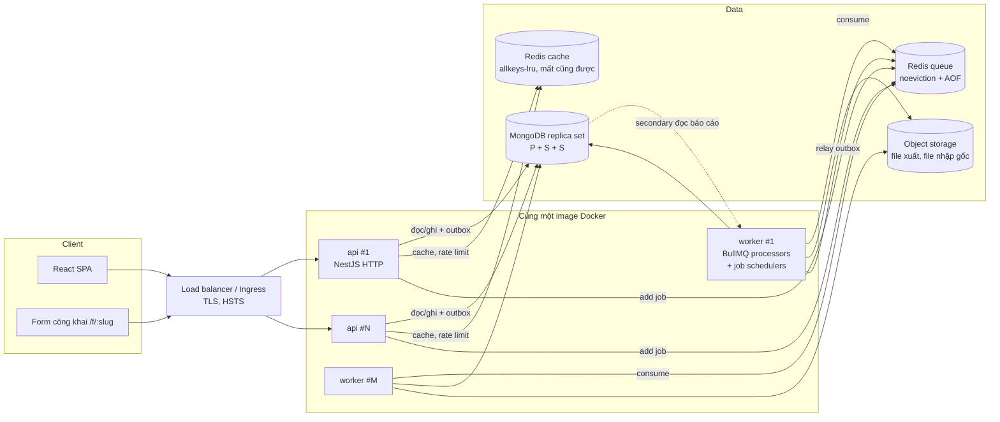
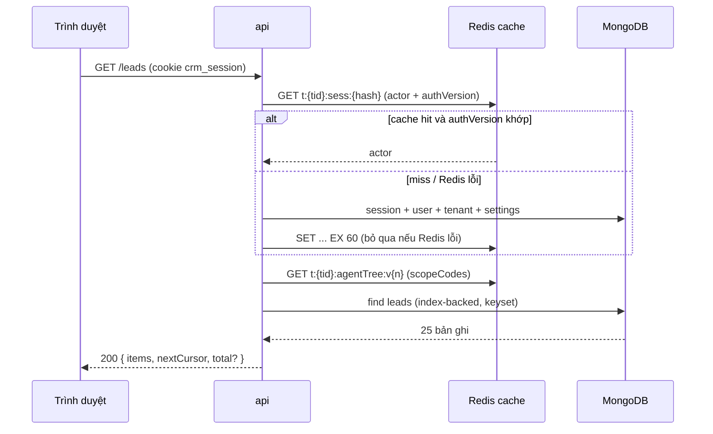
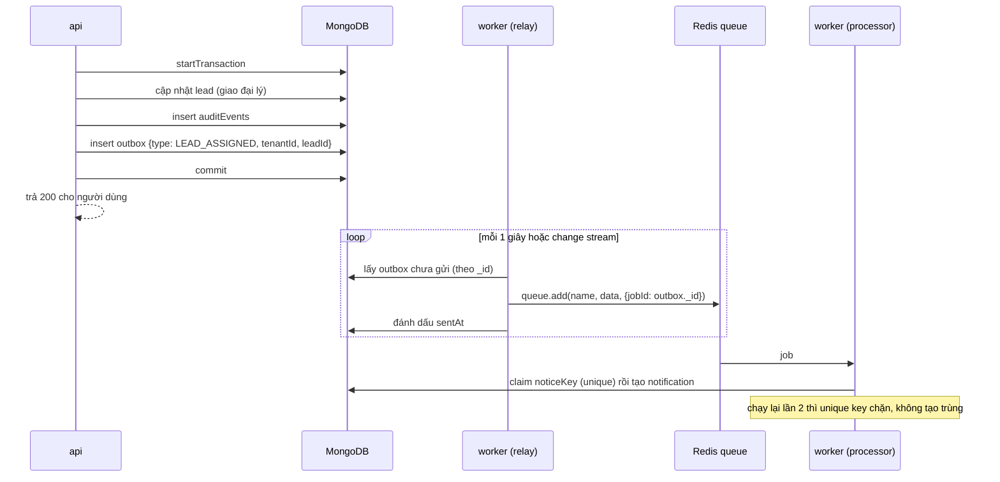
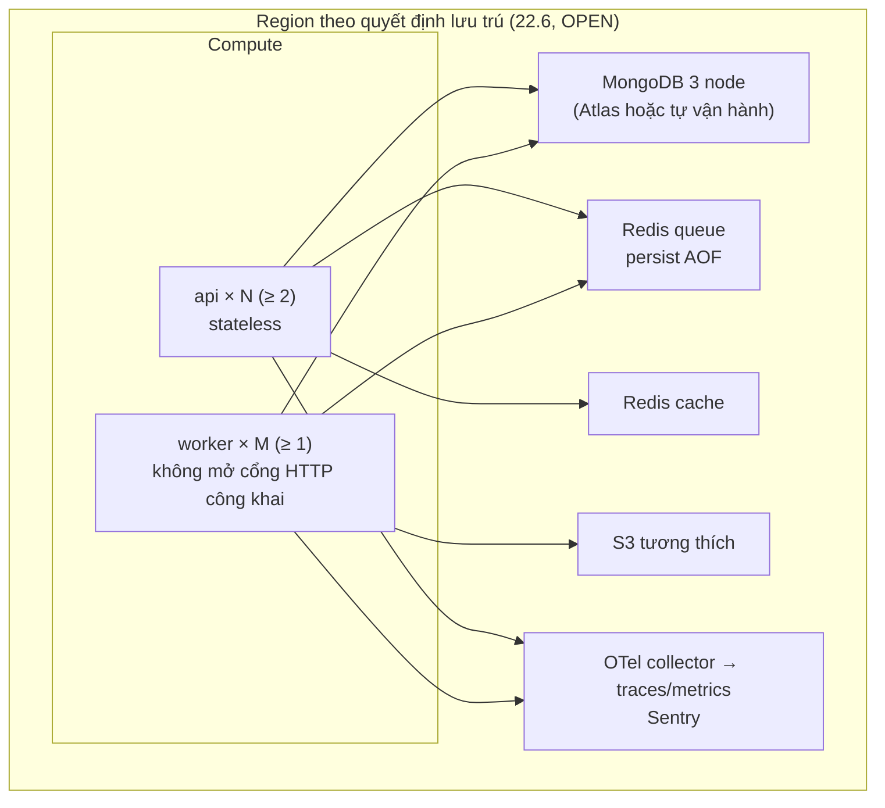

# Đánh giá kiến trúc backend GA CRM cho khoảng 2.000 người dùng đồng thời

> Bản cũ, không cập nhật nữa. Thiết kế hệ thống đích nằm ở [thiet-ke-he-thong.md](thiet-ke-he-thong.md). Tài liệu này chỉ còn giá trị tham khảo về điểm nghẽn của code hiện tại (MongoDB).

Ngày lập: 11/11/2026. Phạm vi: backend NestJS + MongoDB hiện có trong repo này. Tài liệu chỉ đề xuất, chưa có thay đổi code nào đi kèm.

## 0. Cách đọc tài liệu

Mỗi con số đều được gắn nhãn cho biết nó đến từ đâu:

| Nhãn | Nghĩa |
|---|---|
| **[Code]** | Đọc trực tiếp từ code hiện tại |
| **[Đặc tả]** | Lấy từ `requirement/22-yeu-cau-phi-chuc-nang.md` hoặc `02-kien-truc-va-cong-nghe.md` |
| **[Tài liệu]** | Lấy từ tài liệu chính thức, có link ở mục 18 |
| **[Giả định]** | Tự đặt ra để tính toán. Phải xác nhận lại |
| **[Ước tính]** | Tính ra từ giả định. Không dùng để quyết định nếu chưa có load test |

Kết luận quan trọng nhất trước: **hiện chưa có bằng chứng nào cho thấy hệ thống chịu được 2.000 người dùng đồng thời, và cũng chưa có bằng chứng ngược lại**. Hệ thống chưa từng được load test. Tài liệu này chỉ ra những điểm nghẽn đọc được từ code, cách sửa từng điểm, và cách đo để biết khi nào đã đủ.

---

## 1. Đánh giá kiến trúc tổng thể

### 1.1 Hiện trạng

| Hạng mục | Hiện trạng | Nguồn |
|---|---|---|
| Kiểu kiến trúc | Modular monolith NestJS 12, 15 module, khoảng 30 nghìn dòng TypeScript ở `backend/src/modules` | [Code] |
| Database | MongoDB, Mongoose 9, replica set một node khi dev, có transaction, 75 định nghĩa index | [Code] |
| Cô lập tenant | `tenantGuardPlugin`: query thiếu `tenantId` sẽ bị chặn. Index bắt đầu bằng `tenantId` | [Code] |
| Phiên đăng nhập | Cookie `crm_session`, lưu hash SHA-256 trong `sessions`. Mỗi request đọc lại session, user, tenant và cấu hình, rồi gia hạn session | [Code] |
| Audit | Ghi trong cùng transaction. Chuỗi hash theo tenant: mỗi lần `audit.record` đọc rồi ghi đè một document `AuditChain` chung của tenant | [Code] `audit.service.ts:51` |
| Job nền | `RemindersService` chạy mỗi 60 giây trong chính tiến trình API, dùng lease trong `jobLocks` | [Code], decisions.md |
| Nhập dữ liệu | Đồng bộ, trong request. Chia lô 500 dòng, nhưng cả lần nhập (tối đa 20.000 dòng) commit trong một transaction | [Code] |
| Báo cáo | Aggregation chạy trực tiếp khi mở báo cáo | [Code] |
| Rate limit | `@nestjs/throttler` lưu trong bộ nhớ, nên mỗi tiến trình đếm riêng. Bộ đếm đăng nhập sai thì lưu trong MongoDB | [Code], decisions.md |
| Thông báo | Chuông gọi `/notifications/unread` mỗi 60 giây cho mỗi người dùng | [Code] `queries.ts:172` |
| Xuất Excel | Dựng file trong trình duyệt | [Code] |
| Redis, BullMQ, S3 | Chưa có. Đặc tả mục 2.2 có yêu cầu cả ba | [Code], [Đặc tả] |

### 1.2 Những điểm làm tốt, cần giữ

- **Tách quy tắc nghiệp vụ thành hàm thuần** (`client-rules.ts`, `lead-link.ts`, `agent-plan.ts`, `notification-rules.ts`). Kiểm thử nhanh, và có thể dùng lại trong worker.
- **Cô lập tenant bằng plugin** chứ không trông vào việc người viết code nhớ thêm điều kiện. Đây là phần khó làm lại nhất, và nó đang chạy đúng.
- **Phân trang danh sách khách hàng không bị N+1**: hợp đồng và tên đại lý được đọc gộp một lần cho cả trang (`clients.service.ts:393-400`).
- **Idempotency cho thông báo** đã có: unique index trên `noticeKeys` `{tenantId, key}`. Đây chính là nền cho phần xử lý job "ít nhất một lần" ở mục 7.
- **Có 590 test**, trong đó 325 test e2e, nên có thể refactor mà vẫn yên tâm.

### 1.3 Các điểm nghẽn, xếp theo mức ảnh hưởng

Các điểm dưới đây đọc được từ code. Mức ảnh hưởng là **[Ước tính]**, cần đo lại bằng k6 (mục 12).

| # | Điểm nghẽn | Vì sao nghẽn khi tải tăng | Mức |
|---|---|---|---|
| B1 | **Chuỗi hash audit theo tenant** | Mọi lệnh ghi có audit trong cùng một GA đều phải cập nhật cùng một document `AuditChain`. Các transaction đồng thời sẽ gặp write conflict, rồi bị retry hoặc phải chờ nhau. Vì xem chi tiết khách hàng cũng ghi audit (VIEW_CLIENT), ngay cả thao tác đọc cũng bị kéo vào hàng chờ này. Một GA có 500 đại lý cùng thao tác buổi sáng sẽ cảm nhận rõ nhất | Cao |
| B2 | **Mỗi request tốn 4–5 lượt đọc DB chỉ để xác thực** (session, user, tenant, cấu hình, gia hạn) | Tạo ra tải nền trên MongoDB, tỉ lệ thuận với số request. Đây là những lần đọc theo khóa nên mỗi lần đều nhanh. Cái tốn là số vòng gọi mạng và số kết nối bị giữ trong pool | Cao |
| B3 | **Sắp xếp danh sách lead theo trường tính toán** (`overdueRank`, `nextRank` được tạo bằng `$addFields`, `leads.service.ts:836`) | Không index nào phục vụ được phép sắp xếp này, nên MongoDB phải đọc mọi lead khớp bộ lọc rồi mới sắp xếp. Cộng thêm `skip` và `countDocuments` trên cùng bộ lọc. Với 200 nghìn lead mỗi tenant [Đặc tả], người quản lý xem toàn GA sẽ khó đạt p95 < 500 ms | Cao |
| B4 | **Nhập 20.000 dòng trong một transaction, ngay trong request** | Transaction của MongoDB mặc định chỉ sống 60 giây [Tài liệu]. Request HTTP bị giữ lâu, và transaction lớn còn gây áp lực lên cache của WiredTiger (`TransactionTooLargeForCache`) [Tài liệu]. Đặc tả muốn nhập chạy trong worker | Cao |
| B5 | **Rate limit lưu trong bộ nhớ** | Khi có N bản API, giới hạn thực tế thành N lần. Điều này đã được ghi trong decisions.md | Cao, khi bắt đầu chạy nhiều bản |
| B6 | **Job định kỳ chạy trong tiến trình API** | Lease giúp không chạy trùng, nhưng vòng quét buổi sáng chiếm CPU và event loop của chính tiến trình đang phục vụ người dùng | Trung bình |
| B7 | **Báo cáo aggregation chạy trực tiếp** | Đặc tả cho phép dùng snapshot (< 2 giây). Nhiều người mở báo cáo tháng cùng lúc sẽ tranh tài nguyên với các lệnh ghi trên primary | Trung bình |
| B8 | **Tìm khách hàng và lead bằng regex không neo đầu** (`nameNorm: /abc/`, `phone: /123/`) | Phải quét toàn bộ index, có khi cả collection, trong phạm vi tenant | Trung bình |
| B9 | **Phạm vi nhìn thấy (`scopeCodes`) tính lại ở mỗi request** | Lần nào cũng đọc lại cây đại lý của tenant | Trung bình |
| B10 | **Chuông thông báo hỏi lại mỗi 60 giây** | 2.000 ÷ 60 ≈ 33 request/giây [Ước tính]. Không lớn, nhưng mỗi request vẫn chịu B2 | Thấp |
| B11 | **Băm mật khẩu scrypt khi đăng nhập** | scrypt chạy trên threadpool của libuv, mặc định chỉ 4 luồng. Nếu đầu giờ sáng nhiều người đăng nhập cùng lúc, request sẽ phải xếp hàng | Chưa rõ, cần đo |

### 1.4 Quyết định kiến trúc

**Giữ modular monolith và tách thành hai tiến trình từ cùng một codebase: `api` và `worker`. Không chuyển sang microservices.**

Lý do:

1. **Tải không nằm ở chỗ cần tách dịch vụ.** Cả B1 đến B11 đều do cách truy cập dữ liệu và việc chạy đồng bộ, không do các module dính vào nhau. Tách microservices không sửa được điểm nào, nhưng lại thêm gọi qua mạng, transaction phân tán và audit trải trên nhiều dịch vụ. Riêng quy tắc "audit trong cùng transaction" (CLAUDE.md số 4) gần như không làm được nếu mỗi dịch vụ có database riêng.
2. **Phần lớn nghiệp vụ cần transaction xuyên module** (lead, khách hàng, việc cần làm, thông báo, audit). Monolith giữ được điều này với chi phí thấp nhất.
3. **Một tiến trình worker riêng là đủ** để tách việc nặng (nhập, xuất, nhắc việc, báo cáo, AI sau này) khỏi đường đi của request. Đặc tả mục 2.2 cũng muốn "worker chạy riêng".
4. **Có thể scale ngang API** khi nó không giữ trạng thái: session ở MongoDB, cache và rate limit ở Redis, job ở BullMQ.

Đây không phải bảo đảm rằng hệ thống sẽ chịu được 2.000 người dùng. Bảo đảm chỉ có sau khi chạy kịch bản k6 ở mục 12 trên môi trường giống production.

---

## 2. Sơ đồ

### 2.1 Kiến trúc đích



### 2.2 Đường đi của một request đã đăng nhập (sau khi sửa B2, B9)



### 2.3 Ghi có tác dụng phụ bất đồng bộ (outbox)



### 2.4 Triển khai



---

## 3. Cấu trúc thư mục NestJS

### 3.1 So sánh hai phương án

| Tiêu chí | A. Modular monolith, một ứng dụng | B. Monorepo `apps/` + `libs/` (Nest monorepo mode hoặc Nx) |
|---|---|---|
| Hình dạng | Một `backend/`, chia `modules/<tên>` | `apps/api`, `apps/worker`, `libs/domain`, `libs/db`... |
| Tách tiến trình | Hai entrypoint `main.ts` và `worker.ts` trong cùng bản build | Mỗi app build riêng |
| Ranh giới module | Theo quy ước, có thể ép bằng lint | `libs` có `index.ts` công khai, ép chặt hơn |
| Chi phí chuyển đổi từ hiện tại | Thấp: thêm thư mục, không phải dời 30 nghìn dòng | Cao: dời file, đổi đường dẫn import, cấu hình build và test lại |
| Build và test | Một `tsconfig`, một cấu hình vitest | Nhiều project, cần cache build (Nx/Turborepo) mới nhanh |
| Phù hợp khi | Một đội, một sản phẩm, deploy cùng nhau | Nhiều đội, hoặc các app có dependency rất khác nhau |

### 3.2 Chọn A, có cải tiến

Chọn **A**. Đội đang nhỏ, API và worker luôn deploy cùng một phiên bản, và 590 test hiện có đang chạy trên cấu trúc A. Chỉ chuyển sang B khi có một deployable thứ ba với dependency khác hẳn (ví dụ một dịch vụ AI dùng LangGraph và nhiều thư viện nặng), hoặc khi frontend cần dùng chung một gói contract.

Đặc tả mục 2.2 mô tả monorepo `apps/web`, `apps/worker`, `packages/*` cho Next.js. Cấu trúc A với hai entrypoint đáp ứng được mục tiêu của đặc tả là chạy worker riêng. Nếu PO đồng ý thì ghi điểm khác biệt này vào `decisions.md`.

```text
backend/
  src/
    main.ts                    # Tiến trình api: chỉ HTTP. Không đăng ký processor hay scheduler
    worker.ts                  # Tiến trình worker: NestFactory.createApplicationContext(WorkerModule), không mở cổng
    app.module.ts              # ApiModule: controller + service
    worker.module.ts           # WorkerModule: cùng service, cộng processor, scheduler, outbox relay
    configure-app.ts
    config/                    # env.validation.ts (đã có)
    common/                    # Phần dùng chung, KHÔNG chứa nghiệp vụ (đã có)
      auth.decorators.ts  rbac.ts  errors.ts  tenant-guard.plugin.ts  soft-delete.plugin.ts ...
    infra/                     # MỚI: adapter hạ tầng, module nghiệp vụ không import thẳng ioredis hay bullmq
      mongo/
        transaction.ts         # runInTransaction(): retry khi gặp TransientTransactionError, đo số lần retry
        migrations/            # 2026-11-xx-add-sla-due-at.ts ... + runner
      redis/
        redis.module.ts        # Hai client: CACHE_REDIS, QUEUE_REDIS
        cache.service.ts       # Cache-aside, single-flight, TTL có jitter (mục 6.6)
        keys.ts                # Mọi key bắt buộc có tenantId: t:{tid}:...
      queue/
        queues.ts              # Tên queue, cấu hình mặc định cho job
        outbox.schema.ts       # Collection hệ thống, có lý do miễn TEN-2
        outbox.relay.ts        # Chỉ chạy trong worker
        job-context.ts         # Dựng lại Scope và Actor từ dữ liệu job do server ghi
      observability/
        otel.ts  logger.ts  metrics.ts
    modules/
      clients/                 # Ví dụ ở mục 4
      leads/
      imports/
      ...
  test/                        # e2e (giữ nguyên)
```

**Bên trong một module.** Không bắt mọi module phải theo khuôn này. Chỉ tách khi file service vượt khoảng 600 dòng; `leads.service.ts` hiện đã quá 1.800 dòng.

```text
modules/clients/
  clients.module.ts
  api/            clients.controller.ts  clients.dto.ts  client-code.pipe.ts
  application/    clients.service.ts (truy vấn)  client-editor.service.ts (ghi)  client-care.service.ts
  domain/         client-rules.ts  client-insights.ts  lead-link.ts   # hàm thuần, không import Nest hay Mongoose
  data/           client.schema.ts  family.schema.ts  program.schema.ts  client.queries.ts
  jobs/           recompute-client-scope.processor.ts  client-export.processor.ts
```

**Quy tắc ranh giới**, kiểm tra trong CI bằng `dependency-cruiser` (oxlint chưa có luật ranh giới tương đương):

- `domain/` không import gì ngoài `common/` và các hàm thuần.
- Module A chỉ dùng module B qua service mà B export trong `@Module({ exports })`. Không import thẳng schema của module khác. Hiện có vài chỗ dùng `connection.model('User')`, cần dọn dần.
- `api/` không import `infra/queue`. Muốn tạo job thì gọi service ở `application/`.
- `jobs/` chỉ được nạp trong `WorkerModule`.

---

## 4. Thiết kế mẫu: module khách hàng (`clients`)

Đặc tả gọi đây là module khách hàng. Repo đặt tên là `clients`.

### 4.1 Trách nhiệm

| Thành phần | Việc | Đặc điểm tải |
|---|---|---|
| `GET /clients` | Danh sách theo phạm vi nhìn thấy, bộ lọc tín hiệu, tìm kiếm | Đọc nhiều nhất |
| `GET /clients/:code` | Trang khách hàng 360°, ghi audit VIEW_CLIENT | Đọc, kèm một lệnh ghi audit (B1) |
| `GET /clients/counts` | Số lượng theo tín hiệu | Nhiều `countDocuments` |
| `POST /clients/assign` | Giao khách hàng | Ghi theo lô, audit |
| Nhập "Success" | Upsert hàng loạt khách hàng và hợp đồng | Chuyển sang worker (mục 7) |
| `recomputeClientScope` | Tính lại `visibleAgentCodes` khi cây đại lý đổi | Job, theo tenant |

### 4.2 Đọc danh sách

Trạng thái hiện tại [Code]: sắp xếp `{nameNorm, clientCode}`, rồi `skip` và `limit`, chạy song song `countDocuments`. Tìm kiếm dùng regex không neo đầu.

Đề xuất:

1. **Index phục vụ cả lọc phạm vi lẫn sắp xếp.** Bộ lọc chính là `visibleAgentCodes ∈ reach`, sắp xếp theo `nameNorm`:
   ```js
   ClientSchema.index({ tenantId: 1, visibleAgentCodes: 1, nameNorm: 1, clientCode: 1 });
   ```
   Lưu ý: `$in` trên trường mảng và nhiều giá trị cùng lúc có thể khiến MongoDB không dùng index để sắp xếp (SORT_MERGE hoặc in-memory sort). Phải xem `explain('executionStats')` với `reach` thật của một người quản lý GA (vài trăm mã đại lý), không đoán.
2. **Phân trang bằng cursor** (`?after=<nameNorm>|<clientCode>`). Giữ `page` cho các bảng nhỏ, vì UI đang dùng `Pagination` có số trang. Xem đánh đổi ở mục 5.6.
3. **Đếm có giới hạn**: `countDocuments(filter, { limit: 10_001 })`, UI hiển thị "hơn 10.000". Hoặc chỉ đếm khi người dùng đổi bộ lọc, không đếm mỗi lần chuyển trang.
4. **Tìm kiếm**: chuyển sang regex neo đầu (`^`) trên `nameNorm`, `clientCode`, `phone`, vì regex neo đầu dùng được index. Nếu PO vẫn cần tìm theo một phần ở giữa tên, có hai lựa chọn: thêm mảng `nameTokens` (từng từ đã bỏ dấu) có index, hoặc dùng Atlas Search nếu chạy trên Atlas như đặc tả. **Không dùng Redis để che regex chậm.**

### 4.3 Trang 360°

- Đọc song song: khách hàng, hợp đồng, gia đình, tương tác gần nhất, góp ý. Mọi truy vấn đều có index bắt đầu bằng `{tenantId, clientCode}` (đã có).
- **Audit VIEW_CLIENT** vẫn là bắt buộc (CLAUDE.md số 4). Sau khi xử lý B1 (mục 5.10), lệnh ghi này không còn phải chờ chuỗi hash.
- Không cache trang 360°. Dữ liệu cá nhân, mỗi lần xem phải ghi audit, và tỉ lệ trúng cache sẽ thấp.

### 4.4 Ghi

- Mọi lệnh ghi đi qua `runInTransaction()` ở `infra/mongo`, kèm audit.
- **Khóa lạc quan** khi sửa hồ sơ: client gửi lên `version`, server cập nhật với điều kiện `{_id, tenantId, version}`. Nếu không khớp thì trả 409 với mã lỗi mới `stale_version` (mã này phải có trong `errors.ts` và `vi.json`). `PUT /settings` đã làm như vậy.
- Tác dụng phụ (thông báo, tính lại phạm vi) ghi vào `outbox` trong cùng transaction. Không gọi Redis bên trong transaction.

### 4.5 Ví dụ code: truy vấn danh sách kiểu keyset

```ts
// modules/clients/data/client.queries.ts
import { Types, type Model, type QueryFilter } from 'mongoose';
import type { Client } from './client.schema.js';

export type ClientCursor = { nameNorm: string; clientCode: string };

export const encodeCursor = (c: ClientCursor) =>
  Buffer.from(JSON.stringify([c.nameNorm, c.clientCode])).toString('base64url');

export function decodeCursor(raw?: string): ClientCursor | undefined {
  if (!raw) return undefined;
  const [nameNorm, clientCode] = JSON.parse(Buffer.from(raw, 'base64url').toString()) as [string, string];
  // DATA-1: clientCode stays a string so leading zeros survive
  if (typeof nameNorm !== 'string' || typeof clientCode !== 'string') throw new Error('bad cursor');
  return { nameNorm, clientCode };
}

/** Keyset page: index { tenantId, visibleAgentCodes, nameNorm, clientCode } serves filter and order. */
export async function pageClients(
  clients: Model<Client>,
  tenantId: Types.ObjectId,
  clauses: QueryFilter<Client>[],
  after: ClientCursor | undefined,
  size: number,
) {
  const and = [{ tenantId }, ...clauses];
  if (after)
    and.push({
      $or: [
        { nameNorm: { $gt: after.nameNorm } },
        { nameNorm: after.nameNorm, clientCode: { $gt: after.clientCode } },
      ],
    });
  const rows = await clients
    .find({ $and: and })
    .sort({ nameNorm: 1, clientCode: 1 })
    .limit(size + 1)
    .lean();
  const more = rows.length > size;
  const items = more ? rows.slice(0, size) : rows;
  const last = items.at(-1);
  return { items, nextCursor: more && last ? encodeCursor(last) : null };
}
```

Controller trả `{ items, nextCursor, total? }`. Theo quy ước hiện tại `{ items, page, pageSize, total }` thì đây là thay đổi API, nên phải làm cùng frontend trong một lát cắt.

---

## 5. Database

### 5.1 PostgreSQL hay MongoDB

| Tiêu chí | MongoDB (đang dùng) | PostgreSQL |
|---|---|---|
| Cô lập tenant | Plugin ở tầng ứng dụng (đã có, đã test) | Row-Level Security ở tầng DB, chặt hơn |
| Transaction | Có trên replica set. Giới hạn 60 giây, write conflict thì abort cả transaction [Tài liệu] | Mạnh hơn, nhiều mức cô lập, khóa theo dòng |
| Báo cáo nhiều bảng | Aggregation `$lookup`, khó tối ưu hơn | SQL join, planner tốt hơn |
| Dữ liệu dạng cây hoặc linh hoạt (cây đại lý, hồ sơ, form công khai) | Tự nhiên | Dùng JSONB, được |
| Chi phí chuyển đổi | 0 | Viết lại khoảng 30 nghìn dòng service và schema, 75 index, toàn bộ test e2e và plugin tenant |
| Đặc tả | MongoDB Atlas (mục 2.2), shard key `{tenantId, _id}` (22.2) | Không đề cập |

**Quyết định: giữ MongoDB.** Không điểm nghẽn nào trong mục 1.3 là do MongoDB. Đều là do cách dùng. Chuyển database tốn hàng tháng mà không giải quyết B1 đến B11. Chỉ xem lại khi báo cáo phân tích trở thành tải chính, và khi đó lựa chọn hợp lý hơn là thêm một kho phân tích riêng (Postgres hoặc ClickHouse được nạp từ change stream), không thay database chính.

### 5.2 Connection pool

Hiện tại [Code] `app.module.ts:46`: `maxPoolSize: 50`, `waitQueueTimeoutMS: 5000`, `socketTimeoutMS: 30000`. Mặc định của driver là `maxPoolSize 100`, `minPoolSize 0`, `waitQueueTimeoutMS 0` (chờ mãi) [Tài liệu].

Đề xuất:

- Giữ `waitQueueTimeoutMS` hữu hạn. Hết pool thì báo lỗi nhanh, đừng để request treo.
- Đặt `minPoolSize` khoảng 5–10 [Giả định] để không phải mở kết nối mới khi tải tăng đột ngột lúc đầu giờ.
- Tổng số kết nối tới MongoDB = (số bản api × maxPoolSize) + (số bản worker × maxPoolSize của worker). Ví dụ 4 × 50 + 2 × 20 = 240 [Ví dụ tính]. Đối chiếu với giới hạn kết nối của gói Atlas hoặc máy chủ trước khi tăng số bản.
- **Đo thời gian chờ lấy kết nối** bằng các sự kiện CMAP của driver (`connectionCheckOutStarted`, `connectionCheckedOut`, `connectionCheckOutFailed`). Đây là tín hiệu sớm nhất cho thấy pool đã quá nhỏ hoặc truy vấn quá chậm. Tăng `maxPoolSize` khi truy vấn chậm chỉ chuyển hàng đợi từ ứng dụng sang database.

### 5.3 N+1

- Danh sách khách hàng đã đọc gộp [Code].
- Cần rà các chỗ: tên người trong thông báo (đã đọc gộp ở `list`), cột người phụ trách trong danh sách lead, tên tác giả góp ý. Quy tắc: **mỗi trang danh sách chỉ được có số truy vấn cố định**, không tăng theo số dòng.
- Cách phát hiện: bật bộ đếm lệnh Mongo cho từng request (OTel span `mongodb.*` gắn vào span HTTP) và đặt cảnh báo khi một request có hơn khoảng 15 lệnh [Giả định].

### 5.4 Index ghép

Quy tắc ESR (Equality, Sort, Range): trường lọc bằng đứng trước, rồi tới trường sắp xếp, cuối cùng là trường lọc theo khoảng. Luôn bắt đầu bằng `tenantId` (TEN-4).

Index cần thêm hoặc xem lại (mỗi index đều phải chứng minh bằng `explain`):

| Collection | Index đề xuất | Phục vụ |
|---|---|---|
| leads | `{tenantId, deletedAt, slaDueAt, nextActionAt, _id}` (partial: chưa liên hệ) | Phân đoạn "quá hạn" ở mục 5.5 |
| leads | `{tenantId, assignedAgentCode, deletedAt, nextActionAt, assignedAt, _id}` | Danh sách của một đại lý |
| leads | `{tenantId, deletedAt, stage, nextActionAt, _id}` | Kanban theo cột |
| clients | `{tenantId, visibleAgentCodes, nameNorm, clientCode}` | Mục 4.2 |
| notifications | `{tenantId, userId, readAt, createdAt}` | Đếm chưa đọc, danh sách |
| auditEvents | `{tenantId, at}`, `{tenantId, userId, at}` | Màn hình audit |
| outbox | `{sentAt: 1, _id: 1}` (partial: `sentAt: null`) | Relay |

Đồng thời **xóa các index không được dùng**. Mỗi index làm mọi lệnh ghi chậm thêm. Dùng `$indexStats` trên dữ liệu production sau 2–4 tuần để biết index nào không ai dùng.

### 5.5 Sửa danh sách lead (B3)

Phép sắp xếp LEAD-38 là "quá hạn trước, rồi việc sắp tới, rồi mới được giao gần nhất". Trong đó "quá hạn" phụ thuộc thời điểm hiện tại (`assignedAt < now − deadline`), nên không trường lưu sẵn nào có thể sắp xếp thay nó được.

Cách làm:

1. **Lưu sẵn `slaDueAt = assignedAt + deadline`** khi lead được giao mà chưa có liên hệ, quan tâm hay trạng thái chăm sóc. Đặt về `null` khi có liên hệ đầu tiên. Khi GA đổi `deadline`, chạy job tính lại cho tenant đó.
2. **Chia thành hai đoạn, mỗi đoạn đều có index phục vụ**:
   - Đoạn 1: `slaDueAt < now`, sắp theo `nextActionAt, assignedAt desc, _id`.
   - Đoạn 2: phần còn lại, cùng thứ tự sắp xếp.
   - Cursor mang theo tên đoạn: `{seg: 1|2, nextActionAt, assignedAt, _id}`. Khi đoạn 1 hết thì sang đoạn 2.
3. **Đếm**: đếm có giới hạn như mục 4.2, hoặc lấy số lượng từ `GET /leads/counts`.
4. Kết quả phải giống hệt cách sắp xếp hiện tại. Viết test e2e so sánh thứ tự cũ và mới trên dữ liệu seed trước khi bỏ cách cũ.

### 5.6 Phân trang: cursor hay offset

| | Offset (`skip`) | Cursor (keyset) |
|---|---|---|
| Chi phí trang thứ k | Tăng tuyến tính với k, vì phải đọc rồi bỏ k × pageSize bản ghi | Không đổi |
| Nhảy tới trang bất kỳ | Có | Không |
| Ổn định khi dữ liệu đổi | Bị lặp hoặc sót dòng | Ổn định |
| Phù hợp | Bảng nhỏ (người dùng, chiến dịch, audit đã lọc) | Lead, khách hàng, tương tác, thông báo |

Đề xuất: dùng cursor cho lead, khách hàng và thông báo. Giữ offset ở những chỗ còn lại. URL lưu `after=` thay cho `page=` (quy tắc "state trong URL" vẫn giữ được).

### 5.7 `explain` là cổng kiểm tra bắt buộc

Mọi truy vấn danh sách mới hoặc sửa đổi phải có kết quả `explain('executionStats')` trên dữ liệu cỡ đặc tả (200 nghìn lead, 500 nghìn hợp đồng mỗi tenant [Đặc tả]), và đạt:

- `winningPlan` không có `COLLSCAN`, và không có `SORT` trong bộ nhớ ở các truy vấn danh sách chính.
- `totalDocsExamined / nReturned` dưới khoảng 10 [Giả định]. Lý tưởng là gần 1.
- `executionTimeMillis` trên máy staging dưới khoảng 50 ms [Giả định], để còn chỗ cho mạng và serialize trong ngân sách 300 ms.

Cần một script `npm run perf:seed` tạo dữ liệu cỡ đó trong DB `ga_crm_load`, không đụng dữ liệu dev, theo đúng cách của skill `ga-crm-verify`.

### 5.8 Transaction

- Giữ transaction ngắn: chỉ đọc và ghi những gì bắt buộc phải nhất quán với nhau. Không gọi mạng ra ngoài, không gọi Redis, không parse file bên trong transaction.
- Hàm `connection.transaction()` của Mongoose dùng `withTransaction` của driver, tự retry khi gặp `TransientTransactionError`. Vì retry chạy lại cả callback, callback không được có tác dụng phụ bên ngoài DB. Outbox giải quyết điều này.
- **Đo số lần retry và số lần abort.** Nếu con số này cao, đó là dấu hiệu tranh chấp tài liệu nóng (B1).
- Giới hạn 60 giây và kích thước transaction [Tài liệu]: là lý do bắt buộc phải chia nhỏ khi nhập dữ liệu (mục 7.8).

### 5.9 Khóa lạc quan

- Mongoose có tùy chọn `optimisticConcurrency: true`, dựa trên `__v`. Tùy chọn này chỉ có tác dụng với `doc.save()`. Repo này chủ yếu dùng `updateOne` và `findOneAndUpdate`, nên làm theo cách thủ công: có trường `version`, điều kiện cập nhật kèm `version`, và `$inc: { version: 1 }`.
- Áp dụng cho hồ sơ khách hàng, lead (sửa cùng lúc), cấu hình GA (đã có), cấu hình AI.

### 5.10 Sửa chuỗi hash audit (B1)

Yêu cầu AUD-1: hash = SHA-256 của sự kiện cộng với hash trước đó trong tenant. Ba hướng, cần PO chọn (câu hỏi 3, mục 17):

| Hướng | Cách làm | Ưu | Nhược |
|---|---|---|---|
| **H1. Niêm phong bất đồng bộ** | Trong transaction chỉ insert `auditEvents` với `seq` lấy từ ObjectId (không đụng `AuditChain`). Một job trong worker, mỗi tenant một luồng, đọc các sự kiện chưa có hash theo thứ tự `_id`, tính chuỗi rồi ghi `hash` và `prevHash` | Hết tranh chấp ngay. Bảo đảm "audit trong cùng transaction" vẫn giữ | Có vài giây sự kiện chưa được niêm phong. Thứ tự là thứ tự của ObjectId, không phải thứ tự commit. Bộ kiểm tra chuỗi phải chấp nhận khoảng chưa niêm phong ở cuối |
| **H2. Chia chuỗi** | K chuỗi mỗi tenant, chọn theo `hash(entityId) % K` | Tranh chấp giảm khoảng K lần [Ước tính] | Vẫn còn tranh chấp. Phần kiểm tra phức tạp hơn |
| **H3. Giữ nguyên** | Đo trước, chỉ sửa khi số liệu cho thấy cần | Không đổi gì | Rủi ro lớn nhất cho GA có nhiều người dùng |

Đề xuất: **đo B1 ngay trong giai đoạn 1** (k6 với 200 người dùng ghi cùng lúc trong một tenant, đếm số write conflict và độ trễ). Nếu vượt ngân sách thì làm H1. Đây là thay đổi cách hiểu AUD-1, nên phải được PO và pháp chế đồng ý và ghi vào `decisions.md`.

### 5.11 Replica và đọc từ secondary

- Production: **replica set 3 node** (primary và hai secondary). Đây là điều kiện cho `w: 'majority'`, failover và đạt 99,9% [Đặc tả].
- Mặc định đọc từ primary, để người dùng luôn thấy ngay thứ mình vừa ghi.
- Chỉ những việc chấp nhận dữ liệu cũ vài giây mới dùng `readPreference: 'secondaryPreferred'` kèm `maxStalenessSeconds`: snapshot báo cáo, xuất file, các job phân tích. Không dùng cho danh sách lead và khách hàng.
- Atlas có thể thêm node analytics để báo cáo không tranh tài nguyên với node phục vụ người dùng. Chỉ cần khi số đo cho thấy báo cáo đang làm chậm các lệnh đọc khác.

### 5.12 Migration

- Thêm bảng `migrations` (hệ thống, không có tenant) và một runner chạy **như một bước riêng trước khi deploy** (`node dist/migrate.js`). Không chạy lúc ứng dụng khởi động, vì N bản sẽ chạy cùng lúc.
- Theo kiểu expand và contract: thêm trường hoặc index trước, deploy code biết dùng cả cũ lẫn mới, backfill bằng job theo lô, rồi mới bỏ phần cũ.
- Tạo index trên collection lớn: tạo trước khi deploy code cần đến nó. Theo dõi tiến độ qua `currentOp`.
- Đã từng phải migrate quyền cho tenant cũ (skill `ga-crm-feature`). Đưa việc này vào runner thay vì chạy tay.

### 5.13 Sao lưu

Mục tiêu [Đặc tả]: PITR 7 ngày, snapshot hằng ngày giữ 35 ngày, RPO ≤ 15 phút, RTO ≤ 4 giờ, diễn tập khôi phục mỗi quý.

- Trên Atlas: bật Continuous Cloud Backup. Đó là cách đặc tả đã giả định.
- Nếu tự vận hành: Percona Backup for MongoDB (hỗ trợ PITR) hoặc snapshot đĩa kèm oplog. `mongodump` không đáp ứng RPO 15 phút ở quy mô này.
- Redis queue: bật AOF (mục 6.8). Mất Redis queue không được làm mất dữ liệu nghiệp vụ. Nhờ outbox, mọi job quan trọng có thể dựng lại từ MongoDB.
- Diễn tập: khôi phục vào môi trường riêng, chạy `npm test` phần e2e đọc dữ liệu và kiểm tra lại chuỗi audit.

### 5.14 Phân mảnh (sharding) và phân vùng dữ liệu

- **Chưa cần sharding.** Đặc tả chỉ nêu ứng viên shard key `{tenantId: 1, _id: 1}` "khi cần" [Đặc tả]. Chỉ xem xét khi working set vượt RAM của node lớn nhất hợp lý, hoặc khi lượng ghi vượt khả năng của một primary. Cả hai đều phải đo.
- Thay vào đó: TTL cho dữ liệu hết hạn (đã có với notifications 180 ngày, noticeKeys 60 ngày). Collection lớn nhanh nhất có lẽ là `auditEvents` và `interactions`. Thời gian lưu audit là **OPEN** trong đặc tả 22.6, nên chưa có cơ sở để lưu trữ lạnh hay xóa.
- Mọi index đã bắt đầu bằng `tenantId`, nên khi cần shard, bộ index hiện tại vẫn dùng được.

### 5.15 Cô lập tenant ở tầng dữ liệu

- Giữ `tenantGuardPlugin`. Mọi collection mới (kể cả `outbox`) phải hoặc dùng plugin, hoặc nằm trong danh sách miễn của test TEN-2 kèm lý do.
- `outbox` và `migrations` là collection hệ thống. Relay đọc outbox của mọi tenant nhưng không bao giờ trả dữ liệu cho người dùng. Nó chỉ chuyển `tenantId` sang job. Cần ghi điểm này vào `decisions.md`, cạnh `JobLock`.
- Không có "database cho từng tenant": với khoảng 100 GA, cách đó nhân đôi việc vận hành (index, migration, sao lưu) mà plugin đã đáp ứng yêu cầu cô lập.

---

## 6. Redis

### 6.1 Nguyên tắc

- **Không dùng Redis để che truy vấn chậm.** Truy vấn phải đạt ngân sách khi không có cache (mục 5.7). Cache chỉ dùng để giảm số vòng gọi lặp lại của dữ liệu ít thay đổi.
- Hệ thống phải **chạy đúng khi cache Redis chết**: chậm hơn nhưng không sai và không lỗi.
- Mọi key có tenant: `t:{tenantId}:...`. Key toàn hệ thống dùng tiền tố `sys:`.
- Không cache dữ liệu bị che (masked) theo vai trò nếu key không chứa vai trò. Tốt nhất là không cache dữ liệu cá nhân.

### 6.2 Hai Redis tách biệt

| | Redis cache | Redis queue (BullMQ) |
|---|---|---|
| `maxmemory-policy` | `allkeys-lru` | **`noeviction`** (bắt buộc với BullMQ [Tài liệu]) |
| Persist | Không cần | **AOF** (`appendfsync everysec` [Tài liệu]) |
| Mất dữ liệu | Chấp nhận được | Không chấp nhận (job đang chờ) |
| Client | `enableOfflineQueue: false`, timeout ngắn | Worker: `maxRetriesPerRequest: null`. Queue phía API: `enableOfflineQueue: false` để lỗi nhanh [Tài liệu] |

Lý do tách: chính sách bộ nhớ trái ngược nhau. Một lần cache phình lên có thể làm Redis queue hết bộ nhớ, và với `noeviction` thì lệnh ghi job sẽ bị từ chối. Giai đoạn đầu có thể dùng **hai database logic trên cùng một instance**, nhưng `maxmemory-policy` là cấu hình của cả instance, nên cách này chỉ tạm. Nên tách instance từ khi lên production.

Bản quyền: Redis 8 phát hành theo ba giấy phép, trong đó có AGPLv3, từ tháng 5/2025. Valkey là bản fork theo giấy phép BSD [Tài liệu]. Dùng bản managed (ElastiCache, Memorystore) thì vấn đề bản quyền thuộc về nhà cung cấp. Nếu tự chạy, chọn Valkey hoặc Redis 7.2 trở xuống để khỏi phải xem xét AGPL. BullMQ chạy trên cả hai.

### 6.3 Dùng Redis cho việc gì

| Dữ liệu | Key | TTL | Vô hiệu hóa | Vì sao đáng cache |
|---|---|---|---|---|
| Actor của phiên (B2) | `t:{tid}:sess:{tokenHash}` → `{userId, roles, grants, authVersion, mfaPending}` | 60 giây + jitter | Xóa key khi đăng xuất. Tăng `authVersion` của user khi đổi vai trò, khóa tài khoản hay reset MFA | Mỗi request đều cần |
| Phiên bản quyền của user | `t:{tid}:authv:{userId}` | Không hết hạn (nguồn thật ở MongoDB) | `INCR` khi đổi | Thu hồi quyền tức thì trên mọi bản API |
| Cấu hình và giới hạn tenant | `t:{tid}:settings:v{version}` | 10 phút | Key có `version`, khi đổi cấu hình thì key mới tự được dùng | Đọc mỗi request |
| Cây đại lý và phạm vi (B9) | `t:{tid}:agentTree:v{n}` | 1 giờ | Tăng `n` khi nhập đại lý, đổi cây hay tính lại phạm vi | Tính lại tốn |
| Số thông báo chưa đọc (B10) | `t:{tid}:unread:{userId}` | 5 phút | `DEL` khi có thông báo mới hoặc đánh dấu đã đọc | 33 request/giây [Ước tính] |
| Snapshot báo cáo | `t:{tid}:report:{name}:{scopeHash}:{from}:{to}` | 5–15 phút, hoặc tới lần chạy snapshot kế tiếp | Theo TTL | Aggregation tốn |
| Rate limit | Throttler storage | Theo cửa sổ | Tự hết | Bắt buộc khi có nhiều bản (B5) |
| Khóa và single-flight | `t:{tid}:lock:{name}` | Ngắn | Tự hết | Chống stampede |
| Idempotency key của API | `t:{tid}:idem:{key}` | 24 giờ | Tự hết | Gửi form công khai, nhập file |

**Không cache**: danh sách lead và khách hàng (thay đổi liên tục, phụ thuộc phạm vi và bộ lọc, tỉ lệ trúng thấp), trang 360°, kết quả tìm kiếm.

### 6.4 Thu hồi phiên an toàn khi có cache

Cache phiên chỉ an toàn nếu thu hồi có hiệu lực ngay. USER-10 yêu cầu khóa tài khoản phải xóa phiên ngay lập tức.

- Khi đăng xuất, khóa tài khoản, lưu trữ, reset MFA hay đổi vai trò: xóa session trong MongoDB (như hiện nay), **và** `INCR authv:{userId}`.
- Mỗi request đọc cả `sess` lẫn `authv` trong một lệnh `MGET`. Nếu `authVersion` trong `sess` khác `authv` hiện tại, coi như cache miss và đọc lại MongoDB.
- Nếu Redis không trả lời: đọc MongoDB như hiện nay. Không bao giờ tin cache cũ khi không kiểm tra được phiên bản.
- Gia hạn session (`updateOne` mỗi request [Code] `auth.service.ts:360`): chỉ ghi khi lần gia hạn trước đã cách quá khoảng 5 phút [Giả định], thay vì mỗi request.

### 6.5 Vô hiệu hóa cache

- Ưu tiên **key có phiên bản** (`v{n}`) hơn là xóa key: không có race giữa xóa và ghi lại, key cũ tự hết hạn.
- Khi xóa (`DEL`), làm **sau khi commit** transaction. Làm trong transaction thì nếu transaction abort, cache đã bị xóa oan (vô hại). Nếu làm trước khi ghi DB, một request khác có thể ghi lại giá trị cũ vào cache (có hại).
- Cache chỉ dùng trong một tiến trình (LRU nhỏ trong bộ nhớ, vài giây) cho cấu hình tenant thì được phép, vì TTL ngắn và có phiên bản trong key.

### 6.6 Chống stampede

Khi một key nóng hết hạn, hàng trăm request cùng chạy aggregation. Ba lớp chống:

1. **Jitter TTL** (± 10%) để các key không hết hạn cùng lúc.
2. **Single-flight trong tiến trình**: các request cùng key dùng chung một Promise.
3. **Khóa phân tán ngắn** (`SET lock NX PX 5000`) giữa các bản API. Request không lấy được khóa thì đợi một chút rồi đọc lại cache, nếu vẫn chưa có thì tự tính (không chặn vô hạn).

### 6.7 Code: cache-aside với tenant key, single-flight và lỗi mềm

```ts
// infra/redis/cache.service.ts
import { Inject, Injectable, Logger } from '@nestjs/common';
import type { Redis } from 'ioredis';
import { CACHE_REDIS } from './redis.tokens.js';

const jitter = (seconds: number) => Math.round(seconds * (0.9 + Math.random() * 0.2));
const sleep = (ms: number) => new Promise((r) => setTimeout(r, ms));

/** TEN-1: every cache key carries the tenant. Build keys only through this helper. */
export const tenantKey = (tenantId: string, ...parts: (string | number)[]) =>
  `t:${tenantId}:${parts.join(':')}`;

@Injectable()
export class CacheService {
  private readonly log = new Logger(CacheService.name);
  private readonly inflight = new Map<string, Promise<unknown>>();

  constructor(@Inject(CACHE_REDIS) private readonly redis: Redis) {}

  /**
   * Cache-aside. `load` must be correct and fast on its own: the cache only saves repeats.
   * A Redis failure falls back to `load` and never fails the request.
   */
  async getOrLoad<T>(key: string, ttlSeconds: number, load: () => Promise<T>): Promise<T> {
    const cached = await this.safe(() => this.redis.get(key));
    if (cached != null) return JSON.parse(cached) as T;

    // Single-flight within this process
    const running = this.inflight.get(key);
    if (running) return running as Promise<T>;

    const task = (async () => {
      // Single-flight across processes: one loader, others re-read shortly
      const lockKey = `${key}:lock`;
      const locked = await this.safe(() => this.redis.set(lockKey, '1', 'PX', 5000, 'NX'));
      if (locked === null) {
        await sleep(50 + Math.random() * 100);
        const again = await this.safe(() => this.redis.get(key));
        if (again != null) return JSON.parse(again) as T;
      }
      try {
        const value = await load();
        await this.safe(() => this.redis.set(key, JSON.stringify(value), 'EX', jitter(ttlSeconds)));
        return value;
      } finally {
        if (locked === 'OK') await this.safe(() => this.redis.del(lockKey));
      }
    })();
    this.inflight.set(key, task);
    try {
      return await task;
    } finally {
      this.inflight.delete(key);
    }
  }

  /** Call after the transaction commits, never inside it. */
  async invalidate(...keys: string[]) {
    if (keys.length) await this.safe(() => this.redis.del(...keys));
  }

  private async safe<T>(op: () => Promise<T>): Promise<T | null> {
    try {
      return await op();
    } catch (error) {
      // Counted as a metric; the request carries on against MongoDB
      this.log.warn(`cache unavailable: ${(error as Error).message}`);
      return null;
    }
  }
}
```

```ts
// infra/redis/redis.module.ts (excerpt)
const cacheClient = new Redis(env.REDIS_CACHE_URL, {
  enableOfflineQueue: false, // fail at once when Redis is down
  maxRetriesPerRequest: 1,
  connectTimeout: 500,
  commandTimeout: 100, // a cache slower than this is worse than none
  lazyConnect: false,
});
```

Ví dụ dùng cho cấu hình tenant:

```ts
const settings = await this.cache.getOrLoad(
  tenantKey(scope.tenantId, 'settings', `v${tenant.settingsVersion}`),
  600,
  () => this.settingsRepo.load(scope),
);
```

### 6.8 Khi Redis lỗi

| Sự cố | Hành vi đúng |
|---|---|
| Cache Redis chết | Mọi request đọc thẳng MongoDB. Độ trễ tăng, phải có cảnh báo. Rate limit: xem dòng tiếp theo |
| Throttler storage chết | Chọn **fail-open** cho giới hạn chung (chấp nhận tạm không giới hạn). Giới hạn đăng nhập vẫn chạy vì bộ đếm nằm ở MongoDB [Code]. Đây là lựa chọn bảo mật, nên ghi vào `decisions.md` |
| Queue Redis chết | Lệnh ghi nghiệp vụ vẫn thành công nhờ outbox. Relay retry tới khi Redis sống lại. Những API chỉ có mục đích tạo job (xuất file) trả 503 với mã lỗi mới `queue_unavailable` |
| Queue Redis mất dữ liệu (không có AOF, hoặc failover mất ghi) | Job trong outbox đã `sentAt` nhưng mất khỏi Redis. Cần job "đối soát" quét những outbox đã gửi mà chưa có kết quả sau X phút để gửi lại. Idempotency ở consumer bảo đảm gửi lại không gây trùng |

---

## 7. BullMQ

### 7.1 Nguyên tắc

- **Không có exactly-once.** BullMQ bảo đảm ít nhất một lần: job bị coi là stalled sẽ chạy lại, và job có thể chạy lại sau khi worker crash giữa chừng [Tài liệu]. Mọi processor phải idempotent.
- Job chỉ mang **id và tham số**, không mang dữ liệu cá nhân (PDP, CLAUDE.md số 5). Worker đọc lại dữ liệu từ MongoDB.
- `tenantId` và `actorId` trong job **do server ghi** khi tạo job, lấy từ phiên. Worker dựng lại `Scope` từ đó và **kiểm tra lại quyền** của actor, vì quyền có thể đã đổi từ lúc tạo job (CLAUDE.md số 2).
- Dùng **Job Schedulers** (`upsertJobScheduler`, có từ BullMQ 5.16.0) cho việc định kỳ. Không dùng repeatable job kiểu cũ, vì v6 bỏ các API repeat cũ [Tài liệu].

### 7.2 Danh sách queue

| Queue | Producer | Consumer | Concurrency mỗi worker [Giả định, chỉnh theo số đo] | attempts / backoff | Ghi chú |
|---|---|---|---|---|---|
| `imports` | API sau khi tải file lên (qua outbox) | Kiểm tra và ghi theo lô | 2 | 3, exponential từ 10 giây | Tối đa 1 lần nhập đang chạy cho mỗi tenant (mục 7.9) |
| `exports` | API | Dựng Excel, đưa lên S3, trả link có chữ ký | 2 (tốn CPU, cân nhắc sandboxed) | 3, exponential 5 giây | Audit EXPORT được ghi lúc tạo yêu cầu |
| `notifications` | Outbox relay | Tạo thông báo trong app, sau này là email và web push | 20 (chủ yếu chờ I/O) | 5, exponential 2 giây | Idempotent nhờ `noticeKeys` |
| `client-scope` | Outbox (cây đại lý đổi) | `recomputeClientScope` theo tenant | 1 | 3 | Gộp nhiều thay đổi liên tiếp bằng `jobId` theo tenant |
| `reports` | Scheduler hằng đêm và theo yêu cầu | Snapshot báo cáo | 2 | 3 | Đọc từ secondary |
| `audit-seal` | Scheduler mỗi 2 giây (nếu chọn H1) | Niêm phong chuỗi hash | 1 cho mỗi tenant | Vô hạn, backoff cố định | Thứ tự rất quan trọng |
| `maintenance` | Scheduler | Dọn lead xóa mềm quá 30 ngày, đối soát outbox | 1 | 3 | |
| `reminders` | Scheduler mỗi phút | Thay `RemindersService.tick` | 1 | 1 (lần chạy sau sẽ bù) | Bỏ lease `jobLocks` khi chuyển xong |
| `ai` (để sau) | API | Gọi provider | Theo hạn mức của provider | 3 với 429/5xx, `UnrecoverableError` với 4xx | Giới hạn token theo tenant |

### 7.3 Retry, backoff và lỗi không nên retry

- Lỗi tạm thời (mạng, write conflict, 429, 5xx): để BullMQ retry với backoff exponential.
- Lỗi vĩnh viễn (dữ liệu sai, tenant đã bị khóa, lỗi 4xx của provider): ném `UnrecoverableError` để không retry vô ích.
- Đặt `removeOnComplete: { age: 86400, count: 1000 }` và `removeOnFail: { age: 7 * 86400 }` [Giả định] để Redis không phình.

### 7.4 Dead letter queue

BullMQ không có DLQ có sẵn. Job thất bại ở lần thử cuối sẽ nằm trong tập failed. Cách làm:

- Trong `@OnWorkerEvent('failed')`: nếu `job.attemptsMade >= job.opts.attempts`, ghi một bản tóm tắt (queue, jobId, tenantId, mã lỗi, **không có dữ liệu cá nhân**) vào collection `jobFailures`, rồi bắn metric và cảnh báo.
- Có trang quản trị cho Platform Admin để chạy lại hoặc bỏ qua (runbook "chạy lại ghi nhập" trong đặc tả 22.5).
- Bull Board, nếu dùng, chỉ mở sau xác thực Platform Admin, vì nó lộ payload của job.

### 7.5 Lịch định kỳ

```ts
// worker bootstrap, idempotent across restarts and replicas
await remindersQueue.upsertJobScheduler('reminders-tick', { every: 60_000 }, { name: 'tick' });
await maintenanceQueue.upsertJobScheduler(
  'purge-soft-deleted',
  { pattern: '0 2 * * *', tz: 'Asia/Ho_Chi_Minh' },
  { name: 'purge' },
);
await reportsQueue.upsertJobScheduler(
  'nightly-snapshots',
  { pattern: '30 1 * * *', tz: 'Asia/Ho_Chi_Minh' },
  { name: 'snapshot-all' },
);
```

`snapshot-all` không tự chạy hết mọi tenant. Nó chỉ tạo ra một job cho mỗi tenant, để một tenant lỗi không chặn các tenant khác, và để giới hạn được concurrency.

### 7.6 Idempotency

| Kỹ thuật | Dùng ở đâu |
|---|---|
| `jobId` cố định khi thêm job (trùng `jobId` thì BullMQ bỏ qua khi job cũ còn tồn tại) | Outbox relay: `jobId = outbox._id`. Gộp job tính lại phạm vi: `jobId = scope:{tenantId}:{treeVersion}` |
| Unique index trong MongoDB | `noticeKeys {tenantId, key}` (đã có), `importRows {importId, rowNo}` |
| Upsert theo khóa tự nhiên | Nhập khách hàng theo `clientCode`, hợp đồng theo `policyNo` (DATA-1: chuỗi) |
| Checkpoint | Nhập dữ liệu: lưu `lastCommittedChunk`. Chạy lại thì bắt đầu từ lô tiếp theo |

Lưu ý: chống trùng bằng `jobId` chỉ có tác dụng **khi job cũ còn trong Redis**. Sau khi `removeOnComplete` xóa job, cùng `jobId` có thể được thêm lại. Vì vậy idempotency ở consumer (unique index) là bắt buộc. `jobId` chỉ giúp giảm việc thừa.

### 7.7 Outbox

Vì sao cần: không thể ghi MongoDB và Redis trong cùng một transaction. Nếu commit xong rồi mới `queue.add()` mà tiến trình chết ở giữa thì mất job. Nếu `queue.add()` trước rồi transaction abort thì job xử lý dữ liệu không tồn tại.

```ts
// infra/queue/outbox.schema.ts
@Schema({ collection: 'outbox', timestamps: { createdAt: true, updatedAt: false } })
export class Outbox {
  @Prop({ type: Types.ObjectId, required: true }) tenantId: Types.ObjectId;
  @Prop({ required: true }) queue: string;
  @Prop({ required: true }) name: string;
  @Prop({ type: Object, required: true }) data: Record<string, unknown>; // ids only, no PII
  @Prop({ type: Date, default: null }) sentAt: Date | null;
  @Prop({ default: 0 }) tries: number;
}
// System collection, exempt from TEN-2 with a reason: the relay reads all tenants and never returns rows to users
OutboxSchema.index({ sentAt: 1, _id: 1 }, { partialFilterExpression: { sentAt: null } });
OutboxSchema.index({ createdAt: 1 }, { expireAfterSeconds: 7 * 86400, partialFilterExpression: { sentAt: { $type: 'date' } } });
```

```ts
// Producer, inside the business transaction
await this.outbox.create(
  [{ tenantId, queue: 'notifications', name: 'lead-assigned', data: { leadId, agentCode, actorId } }],
  { session },
);
```

```ts
// infra/queue/outbox.relay.ts (worker only)
@Injectable()
export class OutboxRelay implements OnApplicationBootstrap, OnApplicationShutdown {
  private stopping = false;
  constructor(
    @InjectModel(Outbox.name) private readonly outbox: Model<Outbox>,
    private readonly queues: QueueRegistry,
  ) {}

  onApplicationBootstrap() {
    void this.loop();
  }
  onApplicationShutdown() {
    this.stopping = true;
  }

  private async loop() {
    while (!this.stopping) {
      const batch = await this.outbox.find({ sentAt: null }).sort({ _id: 1 }).limit(200).lean();
      for (const row of batch) {
        try {
          await this.queues.get(row.queue).add(row.name, { ...row.data, tenantId: row.tenantId.toString() }, {
            jobId: row._id.toString(), // duplicate relays collapse while the job exists
          });
          await this.outbox.updateOne({ _id: row._id }, { $set: { sentAt: new Date() } });
        } catch {
          await this.outbox.updateOne({ _id: row._id }, { $inc: { tries: 1 } });
          break; // Redis is likely down; retry the batch later in order
        }
      }
      if (batch.length < 200) await new Promise((r) => setTimeout(r, 1000));
    }
  }
}
```

Có nhiều bản worker thì mỗi bản đều chạy relay. Gửi trùng sẽ bị `jobId` gộp lại, và consumer đã idempotent. Nếu muốn giảm việc thừa, giữ lease trong `jobLocks` như hiện nay. Change stream có thể thay vòng lặp poll khi cần độ trễ thấp hơn 1 giây.

### 7.8 Ví dụ code: processor nhập dữ liệu

```ts
// modules/imports/jobs/import.processor.ts (loaded only by WorkerModule)
import { OnWorkerEvent, Processor, WorkerHost } from '@nestjs/bullmq';
import { UnrecoverableError, type Job } from 'bullmq';

type ImportJob = { tenantId: string; actorId: string; importId: string };

@Processor('imports', { concurrency: 2, lockDuration: 60_000 })
export class ImportProcessor extends WorkerHost {
  constructor(
    private readonly jobContext: JobContext,
    private readonly imports: ImportsService,
  ) {
    super();
  }

  async process(job: Job<ImportJob>) {
    // Scope from server-written job data; permissions re-checked now (CLAUDE.md #2)
    const actor = await this.jobContext.actor(job.data.tenantId, job.data.actorId);
    if (!actor) throw new UnrecoverableError('actor_gone');
    const run = await this.imports.loadRun(actor, job.data.importId); // 404-style miss if other tenant
    if (run.status === 'DONE') return { skipped: true }; // re-delivery after success

    for (let chunk = run.lastCommittedChunk + 1; chunk < run.chunkCount; chunk += 1) {
      // One short transaction per 500 rows: data + audit + checkpoint together (AUD-3)
      await this.imports.commitChunk(actor, run, chunk);
      await job.updateProgress(Math.round(((chunk + 1) / run.chunkCount) * 100));
    }
    await this.imports.finish(actor, run);
    return { rows: run.rowCount };
  }

  @OnWorkerEvent('failed')
  async onFailed(job: Job<ImportJob> | undefined, error: Error) {
    if (job && job.attemptsMade >= (job.opts.attempts ?? 1))
      await this.imports.markFailed(job.data, error.message); // jobFailures + metric, no row content
  }
}
```

Thay đổi về nghĩa: hiện nay cả lần nhập là tất cả hoặc không có gì. Theo lô thì có thể nhập được một phần. Có hai cách giữ được nghĩa cũ:

1. Mỗi dòng được ghi kèm `importId`, và lần nhập chỉ "hiện" khi xong (bộ lọc hiển thị bỏ qua `importId` chưa hoàn tất). Lỗi giữa chừng thì job dọn dẹp xóa hoặc hoàn tác theo `importId`.
2. Chấp nhận nhập một phần, có báo cáo dòng lỗi và cho chạy tiếp từ checkpoint.

Cần PO chọn (câu hỏi 4).

### 7.9 Công bằng giữa các tenant

Đặc tả 22.2 yêu cầu "hàng đợi job công bằng". BullMQ bản mã nguồn mở không có nhóm theo tenant (bản Pro có tính năng Groups, phải trả phí). Cách làm với bản mã nguồn mở:

- Mỗi tenant tối đa một job `imports` đang chạy: khi bắt đầu, `SET t:{tid}:lock:import NX PX ...`. Không lấy được khóa thì `job.moveToDelayed(Date.now() + 15_000, token)` rồi ném `DelayedError`.
- Job tạo hàng loạt (snapshot) mỗi tenant một job nhỏ, không có job khổng lồ.
- Đo thời gian chờ theo tenant. Chỉ cân nhắc BullMQ Pro khi số đo cho thấy cần.

### 7.10 Stalled job

- Worker giữ khóa job và gia hạn định kỳ. Hết `lockDuration` mà không gia hạn thì job bị coi là stalled và được đưa lại vào hàng đợi, nhiều nhất `maxStalledCount` lần [Tài liệu]. Kiểm tra giá trị mặc định của `lockDuration`, `stalledInterval` và `maxStalledCount` theo đúng phiên bản BullMQ đang dùng.
- Nguyên nhân thường gặp nhất là **event loop bị chặn** bởi việc tốn CPU (dựng Excel, parse file lớn), làm khóa không được gia hạn. Hệ quả: job chạy hai lần song song.
- Cách xử lý: việc tốn CPU chạy trong **sandboxed processor** (tiến trình con, chỉ định bằng đường dẫn file). Lưu ý sandboxed processor không có DI của Nest [Tài liệu], nên phần đó phải là hàm thuần nhận dữ liệu và trả kết quả. Hoặc chia thành những đoạn ngắn có `await` xen giữa. Tăng `lockDuration` cho queue có job dài.
- Đo `event loop lag` trong worker (mục 13).

### 7.11 Tắt an toàn

- `app.enableShutdownHooks()` ở cả `main.ts` và `worker.ts`. Khi nhận SIGTERM, Nest đóng các module, và `@nestjs/bullmq` gọi `worker.close()`. Lệnh này chờ job đang chạy xong [Tài liệu].
- `terminationGracePeriodSeconds` (Kubernetes) hoặc `stop_grace_period` (Docker) phải dài hơn một lô dài nhất (một lô nhập 500 dòng), **không phải** cả lần nhập. Checkpoint lo phần còn lại.
- API: ngừng nhận request mới (readiness trả 503) trước, đợi các request đang chạy xong, rồi mới đóng kết nối MongoDB và Redis.

### 7.12 Các tình huống

| Tình huống | Điều xảy ra | Vì sao vẫn đúng |
|---|---|---|
| Worker crash giữa lô 7 của lần nhập | Job stalled, chạy lại từ `lastCommittedChunk + 1` | Mỗi lô là một transaction, nên lô 7 chưa commit thì không có gì |
| Relay gửi xong nhưng chết trước khi ghi `sentAt` | Lần sau gửi lại cùng `jobId` | BullMQ gộp nếu job còn tồn tại. Nếu đã bị xóa thì `noticeKeys` chặn tạo trùng |
| Người dùng bị khóa trong lúc job xuất file của họ đang chờ | Worker kiểm tra lại actor và gặp `UnrecoverableError` | Kiểm tra quyền lúc chạy, không phải lúc tạo job |
| Provider AI trả 429 hàng loạt | Retry với backoff. Limiter của queue giảm tốc | `limiter: { max, duration }` trên worker |
| Redis queue failover mất vài giây ghi | Một số job đã `sentAt` nhưng mất | Job đối soát trong `maintenance` gửi lại |
| Deploy giữa lúc job đang chạy | SIGTERM, `worker.close()` chờ job xong | Grace period dài hơn một lô |

---

## 8. Hiệu năng theo từng endpoint

Ngân sách lấy từ đặc tả 22.1. Phần "hiện trạng" đọc từ code, chưa đo.

| Endpoint | Ngân sách p95 [Đặc tả] | Hiện trạng [Code] | Đề xuất | Đo bằng |
|---|---|---|---|---|
| Mọi request đã đăng nhập (phần xác thực) | Nằm trong ngân sách của endpoint | 4–5 lượt đọc MongoDB, 1 lượt ghi gia hạn | Cache actor có `authVersion` (6.4), gia hạn thưa hơn | Số lệnh Mongo mỗi request |
| `POST /auth/sign-in/email` | Không ghi | scrypt trên threadpool 4 luồng | Đo. Nếu xếp hàng thì tăng `UV_THREADPOOL_SIZE` (ví dụ 8–16 [Giả định]) và giữ tham số scrypt | k6 kịch bản "đăng nhập đầu giờ" |
| `GET /leads` | < 500 ms, kèm bộ lọc và đếm | `$addFields` + sort trong bộ nhớ, `skip`, `countDocuments` | Mục 5.5: hai đoạn, keyset, đếm có giới hạn | `explain` + k6 |
| `GET /leads/board` | < 500 ms [Giả định, giống danh sách] | 50 thẻ mỗi cột, mỗi cột là một truy vấn | Index `{tenantId, deletedAt, stage, nextActionAt}`. Số cột cố định nên không thành N+1 | `explain` |
| `GET /leads/:id` | < 300 ms | Đọc theo `_id` cộng lịch sử và tương tác | Giữ. Kiểm tra số lệnh Mongo | k6 |
| `POST /leads/assign` (≤ 200) | Không ghi | Một transaction, ghi audit cho từng lead | Giữ một transaction (200 là giới hạn hợp lý). Chuyển thông báo sang outbox | Đo số lần retry transaction |
| `GET /clients` | < 300 ms | Regex không neo đầu, `skip` | Mục 4.2 | `explain` |
| `GET /clients/:code` (360°) | < 800 ms | Nhiều lượt đọc cộng audit VIEW_CLIENT (B1) | Đọc song song. B1 theo mục 5.10 | k6 |
| `GET /clients/counts`, `/leads/counts` | < 300 ms [Giả định] | Nhiều `countDocuments` | Gộp vào một `$facet`, hoặc cache 30–60 giây theo phạm vi | k6 |
| `GET /notifications/unread` | < 100 ms [Giả định] | Đếm trên index | Cache theo người dùng (6.3). Cân nhắc SSE ở giai đoạn 3 | k6 kịch bản chuông |
| `GET /reports/*` | < 2 giây hoặc snapshot | Aggregation trực tiếp trên primary | Snapshot hằng đêm cộng cache 5–15 phút. Kỳ báo cáo đang diễn ra thì tính trên secondary | k6 với 20 người mở báo cáo cùng lúc |
| `POST /reports/exports`, xuất Excel | Không chặn request | Dựng trong trình duyệt | Job `exports`, file lên S3, link có chữ ký | Thời gian job |
| Nhập dữ liệu (commit) | 2.000 dòng < 30 giây, 20.000 dòng < 3 phút (worker) | Đồng bộ, một transaction | Mục 7.8 | Đo thời gian job |
| `POST /public/forms/:slug` | Không ghi | Turnstile cộng ghi lead, có throttle | Throttle lưu ở Redis. Idempotency key để không tạo trùng khi người dùng bấm hai lần | k6 riêng |

Các điểm chung cho mọi endpoint:

- **Projection**: chỉ lấy những trường màn hình cần (`select`). Nhiều danh sách đang trả cả document.
- **`lean()`** cho mọi lệnh đọc (phần lớn đã có).
- **Nén** phản hồi lớn: gzip hoặc brotli ở load balancer, không làm trong Node.
- **NodeAdapter** (`@nestjs/platform-node`): theo benchmark của NestJS, nó cho khoảng 50% RPS cao hơn Express, được khuyên dùng từ v12.3 và dự kiến thành mặc định ở v13 [Tài liệu]. Đây là con số của benchmark Hello World. Với API mà thời gian chủ yếu nằm ở MongoDB, lợi ích thực tế sẽ nhỏ hơn. Chỉ thử ở giai đoạn 3, sau khi đã kiểm tra helmet, cookie-parser và các middleware Express hiện có.

---

## 9. Xác thực và bảo mật

Những phần đã có và cần giữ: cookie HTTP-only, secure ở production [Code]; hash phiên SHA-256; scrypt; MFA TOTP với mã dự phòng; khóa tạm khi đăng nhập sai; Turnstile cho form công khai; mọi route mặc định là private.

Những phần mới phát sinh khi thêm Redis và BullMQ:

| Rủi ro | Biện pháp |
|---|---|
| Cache phiên làm chậm việc thu hồi quyền | `authVersion` (6.4). Kiểm tra bằng test e2e: khóa tài khoản rồi gọi ngay một request, phải nhận 401 |
| Rò rỉ dữ liệu giữa tenant qua key cache | Chỉ được tạo key bằng `tenantKey()`. Test: GA-2 với cùng tham số không đọc được key của GA-1 (TEN-7) |
| Payload job chứa dữ liệu cá nhân | Job chỉ mang id. Thêm lint hoặc review cho `queue.add` |
| Worker tin `tenantId` từ đâu đó ngoài server | Job chỉ được tạo từ service sau khi đã có Scope. Không có endpoint nào nhận `tenantId` để tạo job |
| Redis mở ra mạng | Redis chỉ trong mạng riêng, bật AUTH và ACL (một user cho cache, một user cho queue), TLS khi đi qua mạng không tin cậy |
| Bull Board hoặc trang quản trị job | Chỉ cho Platform Admin, có audit |
| Rate limit theo IP sai khi nằm sau load balancer | `TRUST_PROXY_HOPS` đúng với số proxy thật (đã có biến này). Throttler lưu ở Redis |
| Một tenant gây ồn ảnh hưởng tenant khác | Thêm rate limit theo tenant (đặc tả 22.2) cạnh giới hạn theo IP và theo người dùng. Concurrency theo tenant cho job (7.9) |
| Link xuất file | Link S3 có chữ ký, hết hạn sau 15 phút [Giả định]. Audit lúc tạo yêu cầu (CLAUDE.md số 4) |
| Bí mật | `AI_KEYS_SECRET`, `MFA_KEYS_SECRET`, URL của Redis để trong secret manager. Không ghi vào log và `meta` của audit |
| Quyền DB tối thiểu | Đặc tả: user DB "audit chỉ insert". Nếu chọn H1 (niêm phong), worker cần quyền cập nhật đúng hai trường `hash` và `prevHash`. Tách user DB riêng cho worker |

---

## 10. Scale ngang

Điều kiện để chạy N bản API:

1. **Không giữ trạng thái trong tiến trình**: session ở MongoDB (đã đúng). Rate limit chuyển sang Redis (B5). Không có cache trong tiến trình nào sống lâu hơn vài giây.
2. **Job định kỳ ra khỏi API**: chuyển `RemindersService` sang job scheduler trong worker (B6). Cho đến khi chuyển xong, lease hiện tại vẫn bảo đảm chỉ một bản chạy.
3. **Không cần sticky session**: cookie gửi tới bản nào cũng được. Khi có SSE thì dùng Redis pub/sub để bản API nào cũng đẩy được sự kiện tới người dùng của mình.
4. **Health check tách hai loại**: `liveness` chỉ kiểm tra tiến trình còn sống. `readiness` kiểm tra MongoDB và Redis queue. **Không** kiểm tra Redis cache, vì cache chết thì API vẫn phục vụ được.
5. **Một tiến trình Node cho mỗi container**, scale bằng số container. Không dùng `cluster` trong container.
6. **Keep-alive**: `server.keepAliveTimeout` lớn hơn idle timeout của load balancer, để tránh lỗi 502 ngẫu nhiên.
7. **Autoscale** API theo CPU và p95. Worker theo độ sâu và tuổi của hàng đợi. Giới hạn trên của số bản lấy từ số kết nối MongoDB còn cho phép (mục 5.2).

Đồng hồ: các tác vụ có liên quan tới giờ (nhắc việc, SLA) đã dùng giờ Việt Nam. Máy chủ phải đồng bộ NTP, vì có N bản thì lệch đồng hồ sẽ gây lỗi khó tìm.

---

## 11. Dự trù tải (capacity planning)

### 11.1 Định nghĩa

"2.000 người dùng đồng thời" ở đây được hiểu là **2.000 phiên đang hoạt động trong cùng một khung giờ cao điểm**, không phải 2.000 request cùng một lúc [Giả định]. Nếu ý của PO là khác thì toàn bộ phần dưới phải tính lại (câu hỏi 1).

Quy mô dữ liệu [Đặc tả]: 200 nghìn lead và 500 nghìn hợp đồng mỗi tenant. Toàn hệ thống: 100 GA, 20 nghìn người dùng, 10 triệu lead.

### 11.2 Mô hình tải

RPS = số phiên × (số thao tác mỗi phút ÷ 60) × số lời gọi API mỗi thao tác, cộng phần chuông thông báo.

| Thông số | Thấp | Trung bình | Đỉnh (8–9 giờ sáng, họp đầu tuần) | Nguồn |
|---|---|---|---|---|
| Số phiên hoạt động | 2.000 | 2.000 | 2.000 | Đề bài |
| Một thao tác mỗi | 60 giây | 30 giây | 10 giây | [Giả định] |
| Số lời gọi API mỗi thao tác | 3 | 4 | 5 | [Giả định], đo lại bằng tab Network của SPA |
| RPS từ thao tác | 100 | 267 | 1.000 | [Ước tính] |
| RPS từ chuông (60 giây mỗi người) | 33 | 33 | 33 | [Ước tính] từ [Code] |
| **Tổng RPS** | **khoảng 135** | **khoảng 300** | **khoảng 1.035** | [Ước tính] |
| Tỉ lệ ghi | 10% | 15% | 20% | [Giả định] |
| Số lệnh Mongo mỗi request, **trước** khi sửa B2 | khoảng 9 | khoảng 9 | khoảng 9 | [Ước tính] 5 cho xác thực + 4 cho nghiệp vụ |
| Số lệnh Mongo mỗi giây, trước | khoảng 1.200 | khoảng 2.700 | khoảng 9.300 | [Ước tính] |
| Số lệnh Mongo mỗi request, **sau** khi sửa B2 | khoảng 4–5 | khoảng 4–5 | khoảng 4–5 | [Ước tính] |
| Số lệnh Mongo mỗi giây, sau | khoảng 600 | khoảng 1.400 | khoảng 4.700 | [Ước tính] |

Con số đáng tin duy nhất ở bảng này là **sửa B2 giảm khoảng một nửa số lệnh gửi tới MongoDB**. Đó là phép tính trực tiếp từ code. RPS tuyệt đối phụ thuộc hoàn toàn vào các giả định về hành vi người dùng.

Ngoài ra còn tải theo đợt, không nằm trong RPS ở trên:

- Đăng nhập đầu giờ: 2.000 lần scrypt trong khoảng 15 phút [Giả định].
- Vòng quét buổi sáng của `RemindersService`.
- Nhập file "Success" hằng tháng.
- Báo cáo cuối tháng.

### 11.3 Ước lượng số bản API: công thức, không phải con số

Hiện không thể nói một bản API chịu được bao nhiêu RPS vì chưa đo. Cách tính:

1. Chạy k6 tăng dần tải trên **một** bản API (giới hạn 1 vCPU), với dữ liệu cỡ đặc tả.
2. Tìm "điểm gãy" `R1`: RPS cao nhất mà p95 của mọi endpoint còn trong ngân sách và tỉ lệ lỗi < 0,5%.
3. Số bản API cần = `ceil(RPS đỉnh ÷ (0,6 × R1)) + 1`. Hệ số 0,6 để còn chỗ cho dao động, cộng 1 để còn chạy được khi mất một bản [Giả định].
4. Kiểm tra lại với N bản. Nếu p95 không giảm khi thêm bản, điểm nghẽn nằm ở MongoDB hoặc ở B1, không phải ở API.

### 11.4 MongoDB

- Working set = index nóng + document nóng. Với 10 triệu lead, mỗi lead giả định khoảng 2 KB [Giả định], dữ liệu lead khoảng 20 GB, chưa tính index và hợp đồng [Ước tính]. Đo thật bằng `db.stats()` và `collStats` trên dữ liệu `perf:seed`.
- Tiêu chí chọn cỡ máy: cache WiredTiger chứa được toàn bộ index nóng. Theo dõi tỉ lệ đọc từ đĩa (`wiredTiger.cache.pages read into cache`).
- Với 2.000 người dùng (khoảng 10% mục tiêu 20 nghìn của đặc tả), một replica set vẫn còn rất xa giới hạn cần shard [Ước tính].

### 11.5 Redis

- Cache: actor của phiên khoảng 1 KB × 2.000 phiên, khoảng 2 MB. Cấu hình tenant và cây đại lý: vài MB. Tổng cộng chỉ vài chục MB [Ước tính]. Một instance nhỏ nhất là đủ.
- Queue: phụ thuộc số job được giữ lại (`removeOnComplete`). Với các giá trị ở mục 7.3: dưới 100 MB [Ước tính].

---

## 12. Load test bằng k6

### 12.1 Kế hoạch

| Bước | Mục đích | Tải | Tiêu chí đạt |
|---|---|---|---|
| 0. Chuẩn bị | Dữ liệu cỡ đặc tả trong `ga_crm_load`, môi trường giống production (replica set 3 node, cùng loại máy) | Không | `perf:seed` xong, `explain` các truy vấn chính đạt mục 5.7 |
| 1. Smoke | Script chạy đúng | 10 VU, 2 phút | 0 lỗi |
| 2. Baseline một bản | Tìm `R1` (11.3) | Tăng dần tới khi gãy | Có số `R1` |
| 3. Tải trung bình | Kịch bản trung bình ở 11.2 | 2.000 VU, 30 phút | Mọi threshold đạt |
| 4. Đỉnh | Kịch bản đỉnh | 2.000 VU với think time 10 giây, 20 phút | Mọi threshold đạt |
| 5. Đăng nhập đầu giờ | B11 | 2.000 lần đăng nhập trong 10 phút | p95 đăng nhập < 1 giây [Giả định] |
| 6. Tranh chấp audit trong một tenant | B1 | 300 VU cùng một GA, tỉ lệ ghi 50% | Không có lỗi `WriteConflict` lọt ra ngoài, p95 ghi < 500 ms [Giả định] |
| 7. Soak | Rò rỉ bộ nhớ, pool | Tải trung bình, 4 giờ | RSS và pool ổn định |
| 8. Sự cố | Hành vi khi Redis cache chết hoặc primary đổi | Tải trung bình, rồi tắt Redis cache hoặc ép failover MongoDB | Không lỗi 5xx kéo dài quá 30 giây [Giả định] |

Lưu ý khi chạy:

- **Không chạy trên dữ liệu dev.** Dùng `NODE_ENV=test`, `MONGO_DB=ga_crm_load`, `TRUST_PROXY_HOPS=1` và đặt `X-Forwarded-For` khác nhau cho từng VU (skill `ga-crm-verify`). Nếu không, giới hạn 60 lần đăng nhập mỗi phút mỗi IP sẽ chặn bài test.
- Tài khoản test là đại lý và trưởng nhóm (không bắt buộc MFA). Giữ `MFA_ENFORCE` như production.
- Chạy k6 từ một máy khác với máy chạy API.
- Xóa `ga_crm_load` sau khi xong.

### 12.2 Script

```js
// load/k6/crm-browse.js
// Run: k6 run -e BASE_URL=https://staging.example/api/v1 -e LOAD_PASSWORD=... load/k6/crm-browse.js
import http from 'k6/http';
import { check, group, sleep } from 'k6';
import { SharedArray } from 'k6/data';
import exec from 'k6/execution';

const BASE = __ENV.BASE_URL;
const PASSWORD = __ENV.LOAD_PASSWORD;
const THINK = Number(__ENV.THINK_SECONDS || 30); // 60 low, 30 average, 10 peak (section 11.2)

// [{ email, clientCodes: ["0001234", ...] }] built by perf:seed; codes stay strings (DATA-1)
const users = new SharedArray('users', () => JSON.parse(open('./users.json')));

export const options = {
  scenarios: {
    browse: {
      executor: 'ramping-vus',
      exec: 'browse',
      startVUs: 0,
      stages: [
        { duration: '5m', target: 500 },
        { duration: '10m', target: 2000 },
        { duration: '30m', target: 2000 },
        { duration: '5m', target: 0 },
      ],
      gracefulRampDown: '30s',
    },
  },
  thresholds: {
    http_req_failed: ['rate<0.005'],
    'http_req_duration{name:GET /leads}': ['p(95)<500'], // section 22.1
    'http_req_duration{name:GET /leads/:id}': ['p(95)<300'],
    'http_req_duration{name:GET /clients}': ['p(95)<300'],
    'http_req_duration{name:GET /clients/:code}': ['p(95)<800'],
    'http_req_duration{name:GET /notifications/unread}': ['p(95)<100'], // assumption
    'checks': ['rate>0.99'],
  },
};

let signedIn = false;
let lastPoll = 0;
const pick = (list) => list[Math.floor(Math.random() * list.length)];

function headers() {
  // A distinct client IP per VU so per-IP limits behave as in production (TRUST_PROXY_HOPS=1)
  const vu = exec.vu.idInTest;
  return { 'Content-Type': 'application/json', 'X-Forwarded-For': `10.${(vu >> 16) & 255}.${(vu >> 8) & 255}.${vu & 255}` };
}

function signIn() {
  const user = users[(exec.vu.idInTest - 1) % users.length];
  const res = http.post(`${BASE}/auth/sign-in/email`, JSON.stringify({ email: user.email, password: PASSWORD }), {
    headers: headers(),
    tags: { name: 'POST /auth/sign-in/email' },
  });
  check(res, { 'signed in': (r) => r.status === 200 && !r.json('mfaRequired') });
  signedIn = res.status === 200;
  return user;
}

export function browse() {
  const user = signedIn ? users[(exec.vu.idInTest - 1) % users.length] : signIn();
  if (!signedIn) return sleep(5);
  const params = (name) => ({ headers: headers(), tags: { name } });

  // Bell: once a minute per user, like the SPA
  if (Date.now() - lastPoll > 60_000) {
    const bell = http.get(`${BASE}/notifications/unread`, params('GET /notifications/unread'));
    check(bell, { 'bell 200': (r) => r.status === 200 });
    lastPoll = Date.now();
  }

  const roll = Math.random();
  if (roll < 0.5) {
    group('leads', () => {
      const list = http.get(`${BASE}/leads?pageSize=25`, params('GET /leads'));
      check(list, { 'leads 200': (r) => r.status === 200 });
      const items = list.status === 200 ? list.json('items') : [];
      if (items.length) {
        const lead = http.get(`${BASE}/leads/${pick(items).id}`, params('GET /leads/:id'));
        check(lead, { 'lead 200': (r) => r.status === 200 });
      }
    });
  } else if (roll < 0.85) {
    group('clients', () => {
      const list = http.get(`${BASE}/clients?pageSize=25`, params('GET /clients'));
      check(list, { 'clients 200': (r) => r.status === 200 });
      if (user.clientCodes.length) {
        const code = encodeURIComponent(pick(user.clientCodes));
        const detail = http.get(`${BASE}/clients/${code}`, params('GET /clients/:code'));
        check(detail, { 'client 200': (r) => r.status === 200 });
      }
    });
  } else {
    group('write', () => {
      // Kept small and reversible on the load database only: a note on one of the user's leads
      const list = http.get(`${BASE}/leads?pageSize=5&mine=1`, params('GET /leads'));
      const items = list.status === 200 ? list.json('items') : [];
      if (items.length) {
        const res = http.post(
          `${BASE}/leads/${pick(items).id}/notes`,
          JSON.stringify({ body: 'k6 load note' }),
          params('POST /leads/:id/notes'),
        );
        check(res, { 'note 201': (r) => r.status === 201 });
      }
    });
  }
  sleep(THINK * (0.5 + Math.random())); // think time with spread
}
```

Trước khi chạy cần kiểm tra lại tên trường và đường dẫn với Swagger (`/docs`), ví dụ `items[].id` và mã lỗi trả về khi ghi chú vào lead không phải của mình. Script dựa trên các route đang có trong controller, nhưng chưa được chạy thử.

---

## 13. Quan sát hệ thống (observability)

Đặc tả 22.5 yêu cầu: log có cấu trúc kèm `tenantId`, `userId`, correlation id, không có PII; trace từ web tới worker tới AI; Sentry; dashboard cho lỗi nhập, chi phí AI và độ sâu hàng đợi.

| Lớp | Công cụ | Nội dung |
|---|---|---|
| Trace | OpenTelemetry SDK cho Node, auto-instrumentation http, mongodb, ioredis. Gửi qua OTel Collector | Mỗi request có span cho từng lệnh Mongo và Redis. **Truyền `traceparent` vào dữ liệu job** để trace nối từ API sang worker |
| Log | `nestjs-pino` (JSON) | `requestId` (đã có `AsyncLocalStorage` trong `request-context.ts`), `tenantId`, `userId`, route, status, thời gian. Lọc bỏ email, số điện thoại, tên |
| Lỗi | Sentry | Gắn tag tenant, không gửi body của request |
| Metric (RED) | OTel metrics hoặc Prometheus | RPS, tỉ lệ lỗi và p50/p95/p99 theo route. Đặt route theo mẫu (`/leads/:id`), không theo URL thật |
| Metric MongoDB | Sự kiện CMAP của driver, profiler, Atlas metrics | Thời gian chờ lấy kết nối, số kết nối, lệnh chậm (> 100 ms [Giả định]), số lần retry và abort của transaction, tỉ lệ đọc từ đĩa |
| Metric Node | `perf_hooks.monitorEventLoopDelay` | Event loop lag p99. Đây là tín hiệu sớm nhất cho cả API (CPU) lẫn worker (stalled job) |
| Metric BullMQ | `queue.getJobCounts()` định kỳ, sự kiện worker | Độ sâu và tuổi job lâu nhất theo queue, tỉ lệ lỗi, số job stalled |
| Metric cache | Tự đếm trong `CacheService` | Tỉ lệ trúng, số lỗi Redis, thời gian chờ khóa single-flight |
| Nghiệp vụ | Metric riêng | Thời gian nhập theo số dòng, độ trễ niêm phong audit (nếu chọn H1), token AI theo tenant |

Cảnh báo tối thiểu [Giả định, chỉnh sau khi có baseline]:

- p95 của một route vượt ngân sách quá 5 phút.
- Tỉ lệ 5xx > 1% quá 5 phút.
- Chờ lấy kết nối Mongo p95 > 50 ms.
- Event loop lag p99 > 200 ms.
- Job lâu nhất trong `imports` chờ quá 2 phút. Bất kỳ job nào vào `jobFailures`.
- Outbox có bản ghi chưa gửi quá 1 phút.
- Redis queue dùng quá 70% `maxmemory`.

---

## 14. Lộ trình ba giai đoạn

### Giai đoạn 1: đo và sửa điểm nghẽn trong code (chưa thêm hạ tầng)

Mục tiêu: biết hệ thống đang đứng ở đâu, và sửa những thứ mà thêm máy cũng không cứu được.

1. `perf:seed` dữ liệu cỡ đặc tả. Kịch bản k6 bước 0–2 và bước 6 (mục 12). Ghi lại baseline.
2. Kiểm tra `explain` cho 10 truy vấn danh sách chính. Sửa B3 (lead, mục 5.5) và B8 (tìm kiếm).
3. B2: giảm số lần đọc để xác thực. Trong giai đoạn này có một bản API nên có thể dùng cache trong tiến trình (TTL 5 giây) cộng với gia hạn thưa hơn. Chuyển sang Redis ở giai đoạn 2.
4. B1: đo. PO chọn H1, H2 hay H3.
5. OTel, log JSON, Sentry, các metric ở mục 13.
6. Replica set 3 node. Sao lưu đáp ứng RPO và RTO, có diễn tập khôi phục.
7. Runner cho migration.

**Điều kiện xong**: có baseline `R1`. Mọi truy vấn chính đạt mục 5.7. Có dashboard.

### Giai đoạn 2: Redis, BullMQ, worker và chạy nhiều bản

1. Hai Redis (cache, queue). `CacheService`, cache actor có `authVersion`, throttler lưu ở Redis.
2. Tạo `worker.ts` và `WorkerModule`. Outbox và relay.
3. Chuyển sang queue: `reminders` (bỏ lease), `notifications`, `imports` (mục 7.8, theo cách PO chọn), `exports` cùng S3, `client-scope`, `maintenance`.
4. Snapshot báo cáo.
5. Chạy ít nhất 2 bản API phía sau load balancer. Readiness và liveness. Tắt an toàn.
6. Nếu đã chọn H1 thì làm niêm phong audit.
7. k6 bước 3, 4, 5, 7, 8.

**Điều kiện xong**: kịch bản đỉnh đạt mọi threshold với N bản tính theo 11.3. Tắt Redis cache không gây lỗi 5xx kéo dài.

### Giai đoạn 3: tối ưu theo số đo

Chỉ làm những mục mà số đo của giai đoạn 2 chỉ ra:

- SSE cho thông báo thay polling, nếu chuông chiếm phần đáng kể tải.
- Đọc từ secondary hoặc node analytics cho báo cáo.
- Thử NodeAdapter.
- Công bằng theo tenant tốt hơn (BullMQ Pro Groups) nếu có tenant gây ồn.
- Queue `ai` khi làm AI 7b–7d.
- Xem lại sharding khi tiến tới mục tiêu 20 nghìn người dùng và 10 triệu lead.

---

## 15. Bảng công nghệ

| Hạng mục | Chọn | Thay thế đã xét | Lý do |
|---|---|---|---|
| Framework | NestJS 12 (giữ) | Tách microservices | Mục 1.4 |
| HTTP adapter | Express (giữ). Thử `@nestjs/platform-node` ở giai đoạn 3 | Fastify | Express là mặc định, middleware hiện có chạy được. Fastify có những điểm khác biệt cần lưu ý [Tài liệu]. NodeAdapter dự kiến thành mặc định ở v13 |
| Database | MongoDB 3 node (Atlas như đặc tả, hoặc tự vận hành) | PostgreSQL | Mục 5.1 |
| ODM | Mongoose 9 (giữ) | Driver thuần | Plugin tenant và soft delete đã dựa vào Mongoose |
| Redis | Managed (ElastiCache hoặc Memorystore). Nếu tự chạy: Valkey | Redis 8 tự chạy | Bản quyền (mục 6.2) |
| Client Redis | ioredis | node-redis | BullMQ dùng ioredis, dùng chung một thư viện |
| Hàng đợi | BullMQ 5.x với `@nestjs/bullmq` | Inngest (đặc tả có nhắc), RabbitMQ, Kafka | Đặc tả mục 2.2 đã chọn. Đủ cho quy mô này. Kafka là quá mức cần |
| Cache | `CacheService` tự viết, mỏng | `@nestjs/cache-manager` | Cần single-flight, key theo tenant, lỗi mềm và key có phiên bản. Viết mỏng còn dễ hơn cấu hình cho đủ |
| Rate limit | `@nestjs/throttler` cộng storage Redis cộng đồng (`@nest-lab/throttler-storage-redis`, được tài liệu NestJS dẫn link) | Tự viết | Giữ throttler hiện có, chỉ đổi nơi lưu |
| Lưu file | S3 tương thích | Lưu trong MongoDB GridFS | Đặc tả mục 2.2 |
| Quan sát | OpenTelemetry, pino, Sentry | APM thương mại | Đặc tả mục 2.2 và 22.5 |
| Load test | k6 | Artillery, JMeter | Script bằng JS, có threshold, scenario |
| Migration | Runner tự viết, có collection `migrations` | `migrate-mongo` | Cần chạy được service Nest và plugin tenant. Nếu không cần thì dùng `migrate-mongo` |
| Kiểm tra ranh giới module | dependency-cruiser | Nx module boundaries | Không phải chuyển sang Nx |
| Sao lưu | Atlas Continuous Backup, hoặc Percona Backup for MongoDB | `mongodump` | RPO 15 phút |

---

## 16. Mức ưu tiên

### Bắt buộc (Must)

1. Load test k6 trên dữ liệu cỡ đặc tả trước khi tuyên bố bất kỳ con số nào.
2. Sửa danh sách lead (B3) và tìm kiếm (B8) để có index phục vụ. Kiểm tra `explain`.
3. Đo B1 và có quyết định về chuỗi hash audit.
4. Giảm số lần đọc khi xác thực (B2), thu hồi quyền vẫn tức thì.
5. Chuyển nhập dữ liệu sang worker với transaction theo lô (B4).
6. Throttler lưu ở Redis trước khi chạy hơn một bản (B5).
7. Outbox cho mọi tác dụng phụ bất đồng bộ. Consumer idempotent.
8. Replica set 3 node. Sao lưu đạt RPO và RTO. Diễn tập khôi phục.
9. Observability tối thiểu ở mục 13. Tắt an toàn cho API và worker.
10. Cô lập tenant ở Redis và queue, có test TEN-7.

### Nên làm (Should)

1. Worker riêng cho reminders, notifications, exports và client-scope.
2. Snapshot báo cáo. Đọc từ secondary cho báo cáo.
3. Phân trang cursor cho lead, khách hàng và thông báo. Đếm có giới hạn.
4. Khóa lạc quan cho các form sửa.
5. Runner migration. dependency-cruiser.
6. Rate limit và concurrency job theo tenant.
7. Tách `leads.service.ts` thành các service nhỏ theo mục 3.2.

### Có thì tốt (Nice to have)

1. SSE cho thông báo.
2. NodeAdapter.
3. Node analytics cho báo cáo.
4. Trang quản trị job cho Platform Admin.
5. Gói contract dùng chung frontend và backend.

### Quá mức cần (Overengineering) ở quy mô này

1. Microservices, service mesh.
2. Kafka hoặc event sourcing hay CQRS đầy đủ.
3. Sharding MongoDB ngay bây giờ.
4. Redis Cluster. Chạy multi-region active-active.
5. Mỗi tenant một database.
6. Cache cho mọi danh sách và mọi trang chi tiết.
7. Chuyển sang PostgreSQL.
8. GraphQL hoặc BFF riêng.

---

## 17. Câu hỏi cần trả lời trước khi thiết kế chi tiết

1. **"2.000 người dùng đồng thời" nghĩa là gì?** 2.000 phiên hoạt động trong giờ cao điểm hay 2.000 request cùng lúc? Cao điểm là khung giờ nào? Người dùng có dồn vào một GA lớn không? Câu trả lời đổi toàn bộ mục 11, và quyết định B1 nghiêm trọng tới đâu.
2. **Hạ tầng đích**: MongoDB Atlas như đặc tả hay tự vận hành? Redis managed hay tự chạy? Region nào (22.6 vẫn OPEN)? Câu trả lời quyết định cách sao lưu, Atlas Search cho tìm kiếm, và giới hạn số kết nối.
3. **Chuỗi hash audit (AUD-1)**: có chấp nhận niêm phong bất đồng bộ (H1, chuỗi được tính sau vài giây bởi worker, theo thứ tự ObjectId) không? Hay phải chia chuỗi (H2), hay giữ nguyên? Cần PO và pháp chế trả lời.
4. **Nhập dữ liệu**: phải giữ tất cả hoặc không có gì (ghi kèm `importId` rồi mới hiện, lỗi thì hoàn tác), hay chấp nhận nhập một phần và chạy tiếp từ checkpoint?
5. **Thông báo**: chậm tối đa 60 giây có chấp nhận được không, hay cần thời gian thực (SSE)? Email và web push có nằm trong phạm vi 2.000 người dùng này không?

---

## 18. Nguồn

Các điểm phụ thuộc phiên bản đã được kiểm tra trên tài liệu chính thức ngày 11/11/2026:

- BullMQ Job Schedulers (từ 5.16.0, thay repeatable job): https://docs.bullmq.io/guide/job-schedulers
- BullMQ chuyển từ v5 lên v6 (bỏ API repeat cũ): https://docs.bullmq.io/guide/migration-to-newer-versions
- BullMQ khi đưa lên production (`noeviction`, `maxRetriesPerRequest: null` cho worker, `enableOfflineQueue: false` cho Queue, AOF, tắt an toàn): https://docs.bullmq.io/guide/going-to-production
- BullMQ stalled job: https://docs.bullmq.io/guide/workers/stalled-jobs
- BullMQ tắt an toàn: https://docs.bullmq.io/guide/workers/graceful-shutdown
- NestJS queues (`@nestjs/bullmq`, `WorkerHost`, sandboxed processor không có DI): https://docs.nestjs.com/techniques/queues
- NestJS performance (NodeAdapter, Express mặc định, lưu ý với Fastify): https://docs.nestjs.com/techniques/performance
- NestJS rate limiting (storage Redis cho nhiều máy chủ): https://docs.nestjs.com/security/rate-limiting
- MongoDB Node driver connection pool (mặc định `maxPoolSize`, `minPoolSize`, `waitQueueTimeoutMS`): https://www.mongodb.com/docs/drivers/node/current/connect/connection-options/connection-pools/
- MongoDB transactions khi đưa lên production (60 giây, write conflict, `TransactionTooLargeForCache`): https://www.mongodb.com/docs/manual/core/transactions-production-consideration/
- Redis trở lại mã nguồn mở với AGPLv3: https://www.theregister.com/2025/05/01/redis_returns_to_open_source/ và https://www.infoq.com/news/2025/05/redis-agpl-license
- Valkey: https://redis.io/blog/what-is-valkey/
