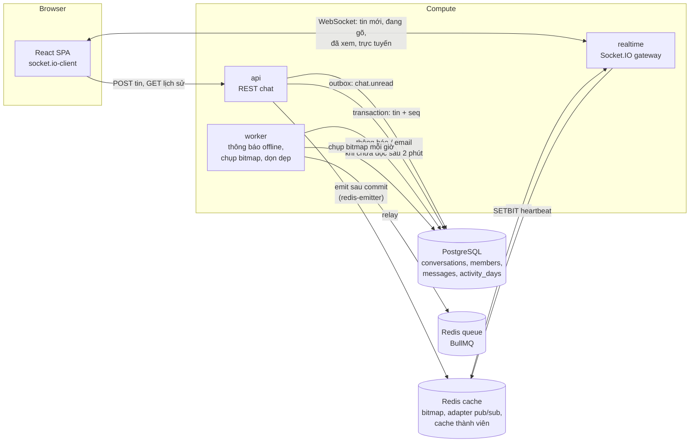

# Thiết kế chat realtime và trạng thái trực tuyến

**Trạng thái:** lát C0-C4 đã làm (14/11/2026, xem `decisions.md`). Khác bản đề xuất bên dưới: file nằm trong `data.files` của tin `TEXT` (bảng `chat_files`), không có kiểu tin `RECORD` / `FILE` và `reply_to_seq`; báo tin chưa đọc chạy trong tiến trình API (chưa có worker). Câu K1, K3, K4, K6, K8 đã có trả lời; K2, K5, K7 còn mở. Chat không có trong đặc tả v2.1, nên đây là module mới. Cần Product Owner trả lời các câu ở mục 11 trước khi làm.

Tài liệu này mở rộng [thiet-ke-he-thong.md](thiet-ke-he-thong.md) mục 7 (Redis) và mục 9 (Realtime). Nó giữ nguyên các nguyên tắc ở đó:

- cô lập tenant bằng RLS;
- một codebase cho cả `api`, `realtime` và `worker`;
- Redis cache được phép mất dữ liệu, PostgreSQL mới là nơi giữ dữ liệu đúng.

---

## 1. Tóm tắt đề xuất

| Câu hỏi | Đề xuất |
|---|---|
| Phạm vi | Chat trong một GA. Có chat 1:1 và chat nhóm, mọi vai trò trong GA đều dùng được. Không có chat giữa các GA |
| Kênh truyền | Socket.IO, chỉ dùng transport `websocket`, có `@socket.io/redis-adapter` khi chạy nhiều bản. Đúng như mục 9 |
| Gửi tin | `POST` qua REST (dùng lại guard, RLS, idempotency, rate limit, kiểm tra origin). Nhận tin, trạng thái đang gõ, đã xem và trực tuyến đi qua WebSocket |
| Lưu tin | PostgreSQL. Mỗi cuộc trò chuyện có số thứ tự tin `seq` tăng liên tục, không bị hụt số. Số tin chưa đọc tính bằng `last_seq - last_read_seq`, không cần một dòng cho mỗi lần đã xem |
| Đẩy tin | Sau khi commit, `api` publish thẳng lên Redis, không đi qua outbox, vì tin đã nằm trong PostgreSQL. Nếu đẩy lỗi, client tự lấy bù theo `seq` khi kết nối lại |
| Trực tuyến | Bitmap Redis chia theo phút: `SETBIT` mỗi lần heartbeat. "Đang trực tuyến" là phép OR của 2 phút gần nhất. Khi một node chết, trạng thái tự hết sau tối đa 2 phút mà không cần dọn |
| Người dùng hoạt động | Bitmap theo ngày: DAU bằng `BITCOUNT`, WAU và MAU bằng `BITOP OR`, tỷ lệ quay lại bằng `BITOP AND`. Mỗi giờ chụp bitmap sang PostgreSQL (`bytea`), vì Redis cache có thể xóa key khi đầy |
| Vị trí bit | Cột mới `users.member_no`: số nguyên liên tục trong từng GA, không bao giờ dùng lại. Không dùng `uuid`, vì bitmap cần vị trí là số nhỏ và liền nhau |

---

## 2. Kiến trúc



- Lúc đầu, gateway `realtime` chạy chung tiến trình với `api` (mục 2.1). Tách ra khi số kết nối làm chậm REST.
- Với khoảng 2.000 người dùng giờ cao điểm (giả định G2) và trung bình 1,3 tab mỗi người, có khoảng 2.600 kết nối [Giả định]. Một tiến trình Node chịu được số kết nối này, nhưng vẫn chạy 2 bản để chịu được khi mất một bản.
- `api` gửi sự kiện bằng `@socket.io/redis-emitter`, nên không cần giữ socket nào.

---

## 3. Dữ liệu (PostgreSQL)

Mọi bảng đều có `tenant_id` và chính sách RLS `FORCE` như các bảng nghiệp vụ khác. Code chỉ chạm tới chúng qua `TenantDb.run`.

### 3.1 Bảng

```sql
-- Dense per-GA number used as the bit offset in Redis bitmaps; never reused, kept after archiving
ALTER TABLE tenants ADD COLUMN member_seq integer NOT NULL DEFAULT 0;
ALTER TABLE users   ADD COLUMN member_no  integer;
ALTER TABLE users   ADD COLUMN last_seen_at timestamptz;   -- flushed from Redis every 5 minutes
CREATE UNIQUE INDEX users_member_no_key ON users (tenant_id, member_no);

CREATE TABLE conversations (
  id              uuid PRIMARY KEY DEFAULT uuidv7(),
  tenant_id       uuid NOT NULL REFERENCES tenants (id),
  kind            text NOT NULL CHECK (kind IN ('DIRECT', 'GROUP')),
  title           text,                         -- GROUP only
  direct_key      text,                         -- DIRECT: '<smaller user id>:<larger user id>'
  created_by      uuid NOT NULL,
  last_seq        bigint NOT NULL DEFAULT 0,
  last_message_at timestamptz,
  archived_at     timestamptz,
  created_at      timestamptz NOT NULL DEFAULT now(),
  updated_at      timestamptz NOT NULL DEFAULT now(),
  CHECK ((kind = 'DIRECT') = (direct_key IS NOT NULL))
);
-- One 1:1 conversation per pair
CREATE UNIQUE INDEX conversations_direct_key ON conversations (tenant_id, direct_key) WHERE direct_key IS NOT NULL;

CREATE TABLE conversation_members (
  tenant_id       uuid NOT NULL REFERENCES tenants (id),
  conversation_id uuid NOT NULL REFERENCES conversations (id) ON DELETE CASCADE,
  user_id         uuid NOT NULL,
  role            text NOT NULL DEFAULT 'MEMBER' CHECK (role IN ('OWNER', 'ADMIN', 'MEMBER')),
  joined_seq      bigint NOT NULL DEFAULT 0,    -- a new member sees history from here
  last_read_seq   bigint NOT NULL DEFAULT 0,
  muted_until     timestamptz,
  pinned_at       timestamptz,
  left_at         timestamptz,
  joined_at       timestamptz NOT NULL DEFAULT now(),
  PRIMARY KEY (conversation_id, user_id),
  FOREIGN KEY (tenant_id, user_id) REFERENCES users (tenant_id, id)
);
CREATE INDEX conversation_members_user_idx ON conversation_members (tenant_id, user_id) WHERE left_at IS NULL;

CREATE TABLE messages (
  tenant_id       uuid NOT NULL REFERENCES tenants (id),
  conversation_id uuid NOT NULL REFERENCES conversations (id) ON DELETE CASCADE,
  seq             bigint NOT NULL,
  id              uuid NOT NULL DEFAULT uuidv7(),
  sender_id       uuid,                         -- null for system messages
  kind            text NOT NULL CHECK (kind IN ('TEXT', 'SYSTEM', 'RECORD', 'FILE')),
  body            text CHECK (length(body) <= 4000),
  data            jsonb NOT NULL DEFAULT '{}',  -- RECORD: {type, id}; FILE: {key, name, size}
  mentions        uuid[] NOT NULL DEFAULT '{}',
  reply_to_seq    bigint,
  client_msg_id   uuid NOT NULL,                -- idempotency: the same send twice is one message
  edited_at       timestamptz,
  deleted_at      timestamptz,
  created_at      timestamptz NOT NULL DEFAULT now(),
  PRIMARY KEY (conversation_id, seq),
  UNIQUE (conversation_id, sender_id, client_msg_id)
);
CREATE INDEX messages_search_idx ON messages USING gin (immutable_unaccent(body) gin_trgm_ops);

-- Durable copy of the daily activity bitmap (Redis may evict it)
CREATE TABLE activity_days (
  tenant_id uuid NOT NULL REFERENCES tenants (id),
  day       date NOT NULL,
  bits      bytea NOT NULL,
  active    integer NOT NULL,                   -- bit_count(bits), kept for reports
  PRIMARY KEY (tenant_id, day)
);
```

`immutable_unaccent` là hàm mới bọc `unaccent` và được đánh dấu `IMMUTABLE`, vì PostgreSQL không cho dùng thẳng `unaccent` trong index. Migration hiện chưa có hàm này.

### 3.2 Gửi một tin: một transaction

```sql
UPDATE conversations
   SET last_seq = last_seq + 1, last_message_at = now(), updated_at = now()
 WHERE id = $1
RETURNING last_seq;                    -- row lock: messages of one conversation get seq 1, 2, 3...

INSERT INTO messages (...) VALUES (..., seq => last_seq, client_msg_id => $clientMsgId)
ON CONFLICT (conversation_id, sender_id, client_msg_id) DO NOTHING;   -- a retry returns the first row

UPDATE conversation_members SET last_read_seq = last_seq
 WHERE conversation_id = $1 AND user_id = $sender;   -- your own message counts as read
```

- Khóa dòng trên `conversations` làm các tin của **cùng một** cuộc trò chuyện ghi lần lượt. Các cuộc khác nhau vẫn ghi song song. Cả GA chung một nhóm thông báo cũng không nghẽn, vì số tin mỗi giây trong một nhóm rất nhỏ.
- Khi gửi lại cùng `client_msg_id`, câu `INSERT ... ON CONFLICT DO NOTHING` sẽ đốt mất một số `seq`. Để không hụt số, kiểm tra `client_msg_id` **trước** câu `UPDATE`.

### 3.3 Chưa đọc, đã xem

- Số chưa đọc của một cuộc trò chuyện là `last_seq - last_read_seq`. Tổng trên chuông là một câu `SUM` trên index `conversation_members_user_idx`.
- Trong nhóm, "Đã xem bởi N người" là số thành viên có `last_read_seq >= seq`. Không lưu một dòng cho mỗi lần xem, nên bảng không phình theo số thành viên × số tin.
- `last_read_seq` chỉ tăng: `SET last_read_seq = GREATEST(last_read_seq, $seq)`.

### 3.4 Dung lượng

Giả sử 2.000 người, mỗi người gửi 50 tin một ngày [Giả định]. Như vậy có 100.000 tin một ngày, khoảng 60 MB tính cả index, khoảng 20 GB một năm. Lúc đầu dùng bảng thường. Khi vượt khoảng 50 triệu dòng thì chia partition theo tháng của `created_at`, và đổi khóa chính thành `(conversation_id, seq, created_at)`. Thời gian lưu tin chờ câu hỏi K3.

---

## 4. API

Tất cả nằm dưới `/api/v1/chat`, cần đăng nhập. Đều đi qua `TenantDb` và chỉ cho thành viên của cuộc trò chuyện. Người không phải thành viên, hoặc người ở GA khác, nhận **404** (TEN-3).

| Route | Việc |
|---|---|
| `GET /chat/conversations?cursor=` | Danh sách cuộc trò chuyện của mình, mới nhất trước, kèm tin cuối và số chưa đọc |
| `POST /chat/direct` `{userId}` | Mở hoặc tạo chat 1:1 (`direct_key`, gặp trùng thì trả bản đã có) |
| `POST /chat/groups` `{title, memberIds}` | Tạo nhóm. Người tạo là `OWNER` |
| `PATCH /chat/groups/{id}` | Đổi tên. `OWNER` / `ADMIN` |
| `POST/DELETE /chat/groups/{id}/members` | Thêm, xóa thành viên, rời nhóm. Ghi một tin `SYSTEM` |
| `GET /chat/conversations/{id}/messages?before=&after=&limit=` | Lịch sử theo `seq`. Không trả tin có `seq < joined_seq` |
| `POST /chat/conversations/{id}/messages` `{clientMsgId, body, mentions?, replyToSeq?, record?}` | Gửi tin |
| `PATCH/DELETE /chat/messages/{conversationId}/{seq}` | Sửa trong 15 phút [Giả định], thu hồi (đặt `deleted_at`, nội dung thành "Tin nhắn đã được thu hồi") |
| `POST /chat/conversations/{id}/read` `{seq}` | Đánh dấu đã đọc tới `seq` |
| `GET /chat/sync?since=` | Sau khi mất kết nối: các cuộc trò chuyện có `updated_at > since` |
| `GET /chat/search?q=` | Tìm trong các cuộc trò chuyện của mình (trigram, bỏ dấu) |
| `GET /presence?userIds=` | Trạng thái của một nhóm người dùng (xem mục 6) |
| `GET /reports/activity?from=&to=` | DAU / WAU / MAU, quyền `reports.view` |

**Gửi hồ sơ trong chat (`RECORD`).** Tin chỉ chứa `{type: 'lead' | 'client', id}`. Người nhận mở thẻ bằng REST với quyền **của chính họ**. Người không có quyền thấy "Bạn không có quyền xem hồ sơ này". Cách này giữ nguyên quy tắc che dữ liệu (CLAUDE.md quy tắc 3): chat không trở thành đường lách để xem dữ liệu không được phép.

Mã lỗi mới, kèm câu trong `vi.json`:

- `chat_not_member`: trả 404 như `not_found`, chỉ dùng trong log;
- `chat_edit_window_closed`;
- `chat_member_inactive`;
- `chat_group_too_large`.

---

## 5. Realtime (WebSocket)

### 5.1 Kết nối

- Lúc bắt tay, máy chủ đọc cookie phiên, tìm theo hash token (cache Redis `sess` 60 giây kèm `auth_version`), rồi kiểm tra `Origin`. Từ chối khi đang chờ MFA (`mfa_pending`), khi tài khoản không `ACTIVE`, hoặc khi GA bị tạm dừng.
- Socket vào room `user:{userId}` và `t:{tenantId}:presence`. **Không** vào room theo từng cuộc trò chuyện. Tin được đẩy tới room `user:` của từng thành viên bằng `io.to([...memberRooms]).emit(...)`. Đây là một lần publish dù có nhiều room. Cách này cho kết quả đúng ngay khi thành viên thay đổi, không cần cập nhật room đang mở.
- Khi `auth_version` tăng (khóa tài khoản, đổi vai trò, đặt lại MFA) hoặc có đăng xuất, `realtime` nhận `session.revoked` và ngắt socket.

### 5.2 Sự kiện

| Sự kiện | Chiều | Payload | Ghi chú |
|---|---|---|---|
| `chat.message` | S → C | Tin đầy đủ (`conversationId`, `seq`, `sender`, `body`...) | Ngoại lệ so với mục 9 ("chỉ gửi id"): nội dung tin như nhau với mọi thành viên, không có gì để che, nên gửi luôn để đỡ một lượt gọi REST |
| `chat.updated` | S → C | `{conversationId, seq}` | Sửa hoặc thu hồi tin. Client tải lại tin đó |
| `chat.conversation` | S → C | `{conversationId}` | Đổi tên, đổi thành viên. Client tải lại |
| `chat.read` | S → C | `{conversationId, userId, seq}` | Để hiện "Đã xem" |
| `chat.typing` | C → S → C | `{conversationId}` | Không lưu. Client gửi tối đa 1 lần mỗi 3 giây, máy chủ bỏ phần dư. Hết hiệu lực sau 5 giây |
| `presence.heartbeat` | C → S | `{active: boolean}` | Mỗi 30 giây. `active` = có thao tác trong 5 phút gần nhất và tab đang hiện |
| `presence.changed` | S → C | `{online: [...], idle: [...], offline: [...]}` | Chỉ gửi phần thay đổi, tới room presence của GA |
| `notification.new` | S → C | `{id}` | Thay cho việc chuông poll 60 giây |

Mỗi sự kiện từ client có giới hạn tốc độ theo socket: `typing` 1 lần mỗi 2 giây, `heartbeat` 1 lần mỗi 10 giây. Vượt giới hạn thì bỏ qua; vượt nhiều thì ngắt kết nối. Trước khi phát `chat.typing`, máy chủ kiểm tra người gửi có là thành viên không, qua cache Redis `t:{t}:chat:members:{conv}` (SET, có TTL, xóa khi thành viên đổi).

### 5.3 Không mất, không trùng, đúng thứ tự

1. Client tạo `clientMsgId` (uuid), hiện tin ở trạng thái "đang gửi", rồi gọi `POST`. Khi mạng lỗi thì gửi lại cùng id, máy chủ trả đúng tin đã lưu.
2. Client nhận `chat.message` và ghép vào danh sách theo `seq`. Nếu `seq` lớn hơn `seq` cuối đang có + 1, tức là bị hụt, client gọi `GET messages?after=` để lấy phần thiếu.
3. Khi kết nối lại, client gọi `GET /chat/sync?since=<lần đồng bộ cuối>`, rồi lấy tin mới của các cuộc trò chuyện đang mở.
4. Tin trùng (từ REST và từ socket) bị loại theo `(conversationId, seq)`.

Nhờ vậy không cần outbox cho việc đẩy tin, và cũng không cần "connection state recovery" của Socket.IO.

### 5.4 Báo cho người không trực tuyến

`api` ghi một dòng outbox `chat.unread` trong cùng transaction. Worker chờ 2 phút [Giả định]. Nếu lúc đó người nhận vẫn chưa đọc, không tắt tiếng và không trực tuyến, worker gom các tin chưa đọc của mỗi cuộc trò chuyện thành **một** thông báo: "3 tin mới từ nhóm Đội UM2". Kênh gửi đi (trong app, email, web push) chờ câu K6. Chưa có worker (giai đoạn 3) thì bỏ bước này: người dùng thấy số chưa đọc trên biểu tượng chat.

---

## 6. Trực tuyến và người dùng hoạt động bằng Redis bitmap

### 6.1 Vì sao bitmap, và vì sao cần `member_no`

Bitmap Redis là một chuỗi bit. Bit thứ *n* bằng 1 nghĩa là người có số *n* đang trực tuyến hoặc đã hoạt động. Một GA có 5.000 người chỉ cần 625 byte cho mỗi bitmap. Đếm dùng `BITCOUNT`, gộp nhiều mốc thời gian dùng `BITOP OR`, giao nhau dùng `BITOP AND`. Cả ba chạy trên vài trăm byte nên gần như tức thì.

Vị trí bit phải là số nhỏ và liền nhau. `users.id` là uuid nên không dùng được. Đề xuất `member_no` theo từng GA: lấy số trong cùng transaction tạo người dùng bằng `UPDATE tenants SET member_seq = member_seq + 1 RETURNING member_seq`. Số này không bao giờ dùng lại, nên dữ liệu bitmap cũ vẫn đúng người. Có một danh sách cache `t:{t}:roster:v{n}` (mảng `member_no → userId`) để đổi bit ngược ra người dùng. Phiên bản `n` tăng khi có người dùng mới.

Người dùng của nền tảng (`tenant_id` null) không có `member_no` và không vào chat của GA (câu K2).

### 6.2 Key

Phần `{t}` để trong ngoặc nhọn **thật** (hash tag của Redis). Như vậy mọi key của một GA nằm cùng một slot, và `BITOP` vẫn chạy được nếu sau này dùng Redis Cluster.

| Key | Kiểu | TTL | Ghi |
|---|---|---|---|
| `t:{t}:on:{yyyyMMddHHmm}` | bitmap | 3 phút | Bit = có heartbeat trong phút đó |
| `t:{t}:act:{yyyyMMddHHmm}` | bitmap | 3 phút | Bit = heartbeat có `active: true` |
| `t:{t}:dau:{yyyyMMdd}` | bitmap | 35 ngày | Bit = có dùng app trong ngày |
| `t:{t}:seen` | hash `member_no → epoch giây` | Không | Lần cuối thấy. Để hiện "Hoạt động 3 giờ trước" |
| `t:{t}:presence:snap` | string | 30 giây | Bản chụp gần nhất, dùng để tính phần thay đổi |
| `t:{t}:roster:v{n}` | string (JSON) | 1 giờ | `member_no → userId` |

### 6.3 Luồng

**Heartbeat** (mỗi 30 giây mỗi socket, chạy trong một pipeline):

```
SETBIT t:{t}:on:<phút>  <no> 1
EXPIRE t:{t}:on:<phút>  180
SETBIT t:{t}:act:<phút> <no> 1      # only when active
EXPIRE t:{t}:act:<phút> 180
HSET   t:{t}:seen <no> <now>
SETBIT t:{t}:dau:<ngày> <no> 1      # once per user per day per process (in-memory guard)
```

Với 2.600 socket, nhịp này khoảng 90 heartbeat mỗi giây, rất nhẹ với Redis. `t:{t}:dau` cũng được bật khi người dùng gọi REST, để người không mở WebSocket (ví dụ chỉ tải một trang) vẫn được tính.

**Vào mạng:** khi socket kết nối, chạy ngay heartbeat đầu, rồi phát `presence.changed {online: [userId]}`. Không phải chờ tới vòng kế tiếp.

**Rời mạng:** khi một socket ngắt, chờ 5 giây (người dùng có thể đang tải lại trang). Sau đó gọi `io.in('user:' + id).fetchSockets()`; lệnh này hỏi mọi node qua adapter. Nếu không còn socket nào: `SETBIT 0` ở bitmap phút này và phút trước, rồi phát `offline`. Nếu node chết mà không kịp xử lý ngắt kết nối, bit tự hết sau tối đa 2 phút, khi key theo phút hết hạn. Không cần job dọn.

**Ai đang trực tuyến** (một node giữ khóa `t:{t}:lock:presence`, chạy mỗi 15 giây cho từng GA có kết nối):

```
BITOP OR  t:{t}:online  t:{t}:on:<phút>  t:{t}:on:<phút-1>
BITOP OR  t:{t}:active  t:{t}:act:<phút> t:{t}:act:<phút-1>
GET t:{t}:online, GET t:{t}:active      # a few hundred bytes, decoded in Node
```

Kết quả chia làm ba trạng thái:

- **trực tuyến:** có bit trong cả `online` và `active`;
- **vắng mặt (idle):** chỉ có bit trong `online`;
- **ngoại tuyến:** không có bit trong `online`.

So với `t:{t}:presence:snap` rồi phát phần thay đổi. `GET /presence?userIds=` đọc từ cùng bản chụp đó, nên đọc trạng thái không tốn thêm lệnh Redis nào.

**Người dùng hoạt động:**

| Chỉ số | Cách tính |
|---|---|
| DAU hôm nay | `BITCOUNT t:{t}:dau:<hôm nay>` |
| WAU / MAU | `BITOP OR tmp <7 hoặc 30 key ngày>` rồi `BITCOUNT tmp` (tmp có TTL 60 giây) |
| Tỷ lệ quay lại D7 | `BITOP AND tmp <ngày X> <ngày X+7>` rồi `BITCOUNT` ÷ DAU ngày X |
| Ai chưa đăng nhập 30 ngày | Lấy MAU, đảo bit (`BITOP NOT`), đối chiếu danh sách tài khoản `ACTIVE` |

### 6.4 Bền dữ liệu

Redis cache dùng `allkeys-lru` (mục 7), nên bitmap ngày có thể bị xóa khi đầy bộ nhớ.

- Mỗi giờ, và lúc 00:05 cho ngày trước, worker chép bitmap ngày sang `activity_days.bits`. Cột `active` lưu `bit_count(bits)` (PostgreSQL có hàm `bit_count(bytea)` từ bản 14).
- Báo cáo quá 35 ngày đọc từ PostgreSQL. Ở đó `bytea` OR với nhau được bằng cách đổi sang `bit varying`.
- Khi Redis mất bitmap của hôm nay, worker nạp lại từ bản chụp gần nhất bằng `SET`. Chỉ mất tối đa một giờ hoạt động, và trong giờ đó người dùng sẽ được bật bit lại ngay lần gọi kế tiếp.
- Bitmap theo phút (trực tuyến) không cần lưu: mất thì sau 30 giây đã tự đầy lại.
- Một job gộp mỗi 5 phút ghi `t:{t}:seen` xuống cột mới `users.last_seen_at`, để "Hoạt động lần cuối" vẫn đúng sau khi Redis khởi động lại.

### 6.5 So với cách khác

| Cách | Hợp với | Không hợp với |
|---|---|---|
| **Bitmap theo phút + hash `seen`** (đề xuất) | Đếm, gộp nhiều mốc, tự hết hạn khi node chết; DAU / MAU / tỷ lệ quay lại gần như không tốn bộ nhớ | Cần `member_no`; trạng thái ngoại tuyến chậm tới 2 phút khi node chết |
| Sorted set, điểm là thời điểm thấy cuối (`ZADD`, `ZRANGEBYSCORE`) | Liệt kê người trực tuyến, đơn giản | Không làm được DAU / MAU nếu không thêm cấu trúc khác; bộ nhớ khoảng 100 byte mỗi người thay vì 1 bit |
| Đếm kết nối bằng `HINCRBY` khi vào và ra | Ngoại tuyến tức thì | Node chết thì bộ đếm sai mãi, phải có job sửa |
| HyperLogLog (`PFADD`) | Đếm gần đúng với số người cực lớn | Không biết **ai**, chỉ biết bao nhiêu; quy mô 2.000 người không cần |

Ở quy mô này cả hai cách đầu đều đủ nhanh. Bitmap được chọn vì một cấu trúc phục vụ được cả trạng thái trực tuyến lẫn thống kê người dùng hoạt động.

---

## 7. Bảo mật, quyền, PDP

| Chủ đề | Cách làm |
|---|---|
| Cô lập GA | RLS trên mọi bảng chat. Room và key Redis đều có tenant. `realtime` từ chối sự kiện có `conversationId` không thuộc GA của socket. Test TEN-7: người của GA-1 nhận 404 với cuộc trò chuyện của GA-2, và không nhận được sự kiện nào của GA-2 |
| Ai nhắn được cho ai | Mặc định là mọi tài khoản `ACTIVE` trong cùng GA. Có thể giới hạn theo tuyến (câu K1). Quyền mới `chat.use` (cấp mặc định cho mọi vai trò) và `chat.groups.manage` (tạo nhóm lớn cho cả GA) |
| Che dữ liệu | Thẻ hồ sơ trong chat mở bằng quyền của người xem (mục 4). Nội dung gõ tay thì không che được, xem câu K4 |
| PDP | Nhập tin có mẫu giống số CCCD (12 số) hoặc số tài khoản ngân hàng thì cảnh báo trước khi gửi, hoặc chặn hẳn (câu K4). Không đưa nội dung chat cho AI nếu chưa ẩn danh (AI-19, AI-20) |
| Audit | Ghi audit cho tạo nhóm, đổi thành viên, thu hồi tin, xuất lịch sử chat, và khi quản trị xem chat của người khác (nếu được phép, câu K3). **Không** ghi audit cho từng tin gửi đi, vì bản thân bảng `messages` đã là bản ghi không xóa được. Đây là điểm khác quy tắc 4 của CLAUDE.md, cần ghi vào `decisions.md` |
| Tài khoản bị khóa hoặc lưu trữ | Ngắt socket ngay (`auth_version`). Tên vẫn hiện trong lịch sử, có nhãn "Đã nghỉ". Không thể mở chat 1:1 mới với người đó |
| Lạm dụng | Giới hạn 30 tin mỗi phút mỗi người [Giả định], 4.000 ký tự mỗi tin, nhóm tối đa 500 người, trừ nhóm toàn GA |

---

## 8. Giao diện

- Trang `/chat` (nhóm "Làm việc" trên sidebar) có hai cột: danh sách cuộc trò chuyện và nội dung. Trên điện thoại chỉ hiện một cột. Cuộc trò chuyện đang mở nằm trong URL (`?c=<id>`), theo quy tắc "trạng thái nằm trong URL".
- Thanh trên cùng có biểu tượng chat kèm số chưa đọc, cạnh chuông thông báo.
- Avatar có chấm trạng thái: xanh là trực tuyến, xám rỗng là vắng mặt, không có chấm là ngoại tuyến kèm "Hoạt động 5 phút trước". Chấm này dùng lại ở ô chọn người, danh sách người dùng và cây đại lý.
- Danh sách tin dài dùng virtual list (`@tanstack/react-virtual`) và tải thêm khi cuộn lên. Ô soạn tin dùng `Textarea` của bộ kit: Enter để gửi, Shift+Enter để xuống dòng. Gõ @ để nhắc tên, dùng lại `lib/mentions.ts`. Có nút "Gửi hồ sơ" để chọn lead hoặc khách.
- Tạo nhóm và thêm người dùng `Dialog` kèm `PickList`. Menu của tin (trả lời, sửa, thu hồi, sao chép) dùng `RowMenu`.
- `lib/realtime.ts` là một socket dùng chung, mở sau khi đăng nhập và đóng ở `setSessionUser(null)`. Sự kiện đi thẳng vào cache của TanStack Query bằng `setQueryData`. Khi WebSocket không dùng được, chuông và danh sách chat quay về poll 60 giây.
- Mọi chữ hiển thị nằm trong `vi.json` (`chat.*`, `presence.*`).

---

## 9. Lộ trình đề xuất

| Lát | Nội dung | Phụ thuộc | Xong khi |
|---|---|---|---|
| **C0** | Redis (Valkey) trong `docker-compose.yml`, `ioredis`, gateway Socket.IO chạy chung với `api`, xác thực bằng cookie, `notification.new` thay cho poll 60 giây | Không. Đây là phần nhỏ của giai đoạn 3 và 4 | Chuông cập nhật ngay; test ngắt socket khi khóa tài khoản |
| **C1** | `member_no`, trạng thái trực tuyến bằng bitmap, chấm trạng thái trên avatar, thẻ DAU / WAU / MAU trong Báo cáo, `activity_days` | C0 | 2 tab, 2 tài khoản thấy nhau trực tuyến / ngoại tuyến; tắt API một bản thì trạng thái hết sau tối đa 2 phút |
| **C2** | Chat 1:1: bảng, REST, đẩy tin, chưa đọc, đã xem, đang gõ, đồng bộ khi kết nối lại | C0 | Test thứ tự `seq` khi gửi song song, gửi lại không trùng, TEN-7, không phải thành viên thì nhận 404 |
| **C3** | Chat nhóm: tạo, thêm / xóa / rời, vai trò, tin hệ thống, @nhắc tên, tắt tiếng, ghim | C2 | |
| **C4** | Gửi hồ sơ, tìm kiếm, thông báo khi không trực tuyến, gửi file | Worker (giai đoạn 3) cho thông báo; S3 cho file | |

Nên làm C0 và C1 trước. Hai lát này kiểm chứng hạ tầng realtime (xác thực, nhiều bản, Redis) với rủi ro thấp, và dùng ngay được cho thông báo.

Test tải (mục 12 của thiết kế hệ thống): 2.600 socket, 50 tin mỗi giây vào nhóm 500 người, ngắt một bản `realtime` giữa chừng, tắt Redis cache. Khi Redis chết, chat vẫn gửi được qua REST, và client tự poll.

---

## 10. Thư viện cần thêm

| Gói | Nơi dùng |
|---|---|
| `@nestjs/websockets`, `@nestjs/platform-socket.io`, `socket.io` | `backend` |
| `@socket.io/redis-adapter`, `@socket.io/redis-emitter`, `ioredis` | `backend` |
| `socket.io-client`, `@tanstack/react-virtual` | `frontend` |
| Valkey 8 (image Docker) | `docker-compose.yml`, cổng `127.0.0.1:6380` để không đụng Redis khác trên máy |

---

## 11. Câu hỏi cho Product Owner

| # | Câu hỏi | Ảnh hưởng |
|---|---|---|
| K1 | Ai được nhắn 1:1 cho ai: mọi người trong GA, hay chỉ trong tuyến của mình cộng các quản lý? Marketing có nhắn trực tiếp cho FC không? | Quyền, ô chọn người |
| K2 | Nhân viên nền tảng có chat hỗ trợ với GA không? Nếu có thì đó là kênh riêng, có audit đọc chéo GA | Có làm chat giữa nền tảng và GA hay không |
| K3 | Lưu tin bao lâu? Chủ GA hoặc pháp chế có được đọc hay xuất chat của người khác khi điều tra không? | Partition, dọn dữ liệu, audit, quyền mới |
| K4 | Tin có số CCCD, số tài khoản, thông tin sức khỏe thì cảnh báo, chặn, hay cho phép? | PDP, kiểm tra trước khi gửi |
| K5 | Người dùng có được ẩn trạng thái trực tuyến không? | Thêm cài đặt cá nhân |
| K6 | Báo tin chưa đọc qua kênh nào: chỉ trong app, email, hay web push (đặc tả có biến `VAPID_*`)? | Worker, cài đặt thông báo |
| K7 | Trạng thái ngoại tuyến chậm tới 2 phút (khi mạng rớt hoặc máy chủ lỗi) có chấp nhận được không? | Độ dài cửa sổ bitmap, nhịp heartbeat |
| K8 | Có cần gửi file và ảnh ngay từ đầu không, giới hạn dung lượng bao nhiêu? | Phụ thuộc S3 |
