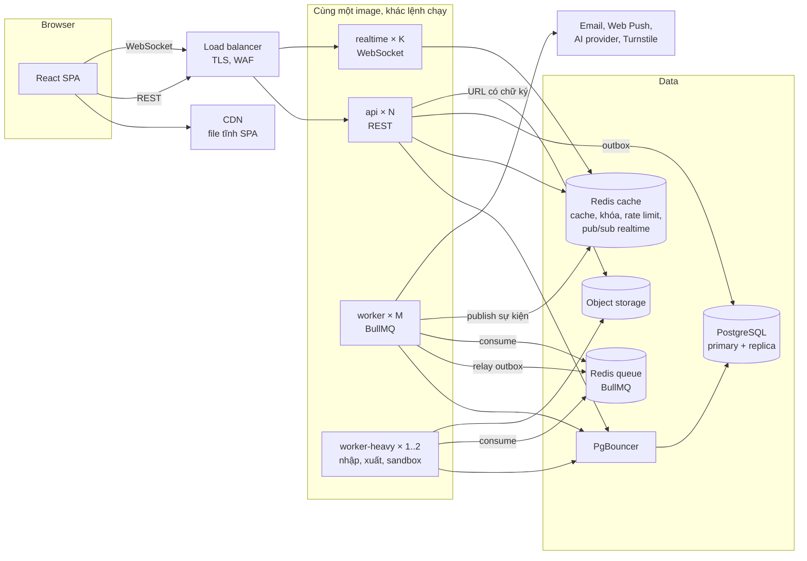
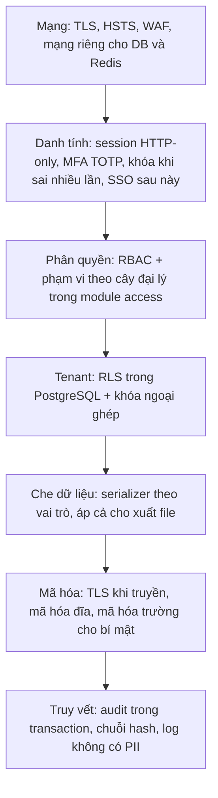

# Thiết kế hệ thống GA CRM

Ngày lập: 11/11/2026. Đây là đề xuất để thảo luận, chưa có code nào đi kèm. Tài liệu thay cho phần kỹ thuật trong `requirement/02-kien-truc-va-cong-nghe.md` và cho `docs/kien-truc-backend.md`. Hai thứ vẫn giữ nguyên: quy tắc nghiệp vụ (mã LEAD-, USER-, CMT-...) và các nguyên tắc bắt buộc trong `CLAUDE.md`.

## 0. Giả định và cách đọc

| # | Giả định | Nếu sai thì sao |
|---|---|---|
| G1 | **Đã xác nhận (11/11/2026):** chưa có GA nào dùng thật trên production, nên đổi database lúc này không phải chuyển dữ liệu | Nếu đã có dữ liệu thật, cần thêm kế hoạch chuyển dữ liệu (mục 13), hoặc giữ MongoDB |
| G2 | **Đã xác nhận (14/11/2026):** 2.000 phiên đang mở trong giờ cao điểm, rải trên nhiều GA; giờ cao điểm tạm giả định 8:00–11:30 và 13:30–17:00 giờ Việt Nam. Mục tiêu là khoảng 2.000 người dùng hoạt động trong giờ cao điểm, quy mô dữ liệu theo đặc tả mục 22 (200 nghìn lead và 500 nghìn hợp đồng mỗi GA) | Mục 12 phải tính lại |
| G3 | Toàn bộ hệ thống chạy trong một region, theo quyết định lưu trú dữ liệu (đặc tả 22.6, còn OPEN) | Nếu phải nhiều region, kiến trúc dữ liệu thay đổi lớn |

Nhãn số liệu: **[Đặc tả]** lấy từ `requirement/22`, **[Tài liệu]** lấy từ tài liệu chính thức (mục 16), **[Giả định]** là số tự đặt và cần xác nhận. Không có con số nào về sức chịu tải được coi là đúng trước khi load test.

---

## 1. Tóm tắt quyết định

| Câu hỏi | Quyết định | Lý do ngắn |
|---|---|---|
| Kiểu kiến trúc | **Modular monolith**: một codebase NestJS, nhiều tiến trình (api, realtime, worker) | Nghiệp vụ cần transaction xuyên module và audit trong cùng transaction. Microservices làm mất điều đó mà không giải quyết được vấn đề tải |
| Database chính | **PostgreSQL** | Dữ liệu CRM có quan hệ chặt. Row-Level Security cô lập tenant ngay trong database. Khóa ngoại, ràng buộc, join, tìm kiếm tiếng Việt bằng `pg_trgm` |
| Cache, khóa, rate limit | **Redis** (hoặc Valkey) | Dữ liệu tạm, truy cập nhanh, dùng chung giữa nhiều bản API |
| Việc nền | **BullMQ** trên một Redis riêng, chạy trong **worker** riêng | Nhập, xuất, nhắc việc, báo cáo, gửi thông báo, AI không chặn request của người dùng |
| Đẩy sự kiện tới trình duyệt | **WebSocket** (Socket.IO, Redis adapter) | Thông báo, cập nhật kanban, tiến độ nhập, người đang xem cùng hồ sơ |
| Stream câu trả lời AI | **HTTP streaming (SSE)** | Luồng một chiều gắn với một request, đi qua proxy dễ, không cần giữ kết nối lâu |
| Đồng bộ dữ liệu giữa DB và các kênh khác | **Transactional outbox** | Không mất sự kiện, không gửi sự kiện cho thay đổi đã bị rollback |
| File | **Object storage** tương thích S3, URL có chữ ký | File nhập gốc, file xuất, tài liệu kiến thức |
| Tìm kiếm | `pg_trgm` + `unaccent` trong PostgreSQL | Đủ cho tên, số điện thoại, mã khách. Chưa cần máy tìm kiếm riêng |
| Vector cho AI | `pgvector` trong PostgreSQL | Không cần thêm database vector riêng ở quy mô này |
| Quan sát hệ thống | OpenTelemetry, log JSON, Sentry | Trace xuyên api, worker và realtime |

---

## 2. Tổng quan hệ thống



### 2.1 Vai trò từng tiến trình

| Tiến trình | Làm gì | Không làm gì | Scale theo |
|---|---|---|---|
| `api` | REST, kiểm tra quyền, ghi dữ liệu kèm audit và outbox trong một transaction | Không chạy việc dài hơn khoảng 1 giây [Giả định], không gửi email, không gọi AI đồng bộ (trừ stream AI) | CPU, p95 |
| `realtime` | Giữ kết nối WebSocket, xác thực, cho vào room, đẩy sự kiện | Không trả dữ liệu nghiệp vụ, chỉ gửi id và loại sự kiện | Số kết nối |
| `worker` | Relay outbox, gửi thông báo, nhắc việc, tín hiệu chăm sóc, báo cáo, AI nền | Không mở cổng HTTP công khai | Độ sâu hàng đợi |
| `worker-heavy` | Nhập file, xuất Excel, việc tốn CPU, chạy trong sandbox | | Số job đang chờ |

Cả bốn tiến trình đến từ **một codebase và một image Docker**, chỉ khác lệnh khởi động (`node dist/main.js`, `dist/realtime.js`, `dist/worker.js --queues=...`). Lúc đầu, `realtime` có thể chạy chung với `api`. Tách riêng khi số kết nối WebSocket ảnh hưởng tới thời gian phản hồi REST.

### 2.2 Đường đi của một thao tác ghi

Ví dụ: Chủ GA giao 50 lead cho một đại lý.

```mermaid
sequenceDiagram
  participant U as SPA
  participant A as api
  participant P as PostgreSQL
  participant W as worker
  participant Q as Redis queue
  participant R as realtime
  U->>A: POST /leads/assign (Idempotency-Key)
  A->>P: BEGIN; set_config('app.tenant_id', ..., true)
  A->>P: UPDATE leads ... WHERE id = ANY(...) AND version = ...
  A->>P: INSERT lead_history, audit_events
  A->>P: INSERT outbox (LeadsAssigned, ids)
  A->>P: COMMIT
  A-->>U: 200 { assigned: 50 }
  W->>P: lấy outbox chưa gửi (FOR UPDATE SKIP LOCKED)
  W->>Q: add job notifications (jobId = outbox.id)
  W->>R: publish "leads.changed" tới room tenant/agent
  R-->>U: sự kiện leads.changed {ids}
  U->>A: refetch danh sách (TanStack Query invalidate)
  Q->>W: job notifications
  W->>P: INSERT notifications ON CONFLICT DO NOTHING
  W->>R: publish "notification.new" tới user:{agent}
```

Bốn nguyên tắc rút ra từ sơ đồ:

1. **Một transaction duy nhất** chứa thay đổi, audit và outbox. Có cả ba hoặc không có gì.
2. **Sự kiện realtime chỉ là tín hiệu.** Trình duyệt tự đọc lại dữ liệu qua REST, nên quyền và việc che dữ liệu chỉ phải kiểm tra ở một nơi.
3. **Mọi bước sau commit đều xử lý ít nhất một lần.** Vì vậy bước nào cũng phải idempotent (`ON CONFLICT DO NOTHING`, `jobId` cố định).
4. **Người dùng nhận phản hồi ngay sau commit.** Thông báo và email đến sau, chậm vài trăm mili giây đến vài giây [Giả định].

---

## 3. Bản đồ chức năng sang công nghệ

Phần chính của tài liệu: mỗi nhóm chức năng của GA CRM dùng công nghệ gì, và vì sao.

| Chức năng | Kỹ thuật | Công nghệ | Vì sao hiệu quả | Bảo đảm nhất quán |
|---|---|---|---|---|
| **Đăng nhập, phiên, MFA** | Session cookie HTTP-only. Bảng `sessions` lưu hash token. Cache thông tin người dùng ngắn hạn kèm `auth_version` | PostgreSQL, Redis cache | Bỏ được 3–4 truy vấn mỗi request. Khóa tài khoản có hiệu lực ngay nhờ tăng `auth_version` | Nguồn đúng nằm ở PostgreSQL. Cache sai phiên bản thì bỏ |
| **Giới hạn đăng nhập sai, rate limit** | Bộ đếm theo cửa sổ thời gian, theo IP, người dùng và tenant | Redis cache (throttler storage) | Đúng khi chạy nhiều bản API | Bộ đếm khóa tài khoản lưu ở PostgreSQL, nên Redis chết thì vẫn khóa đúng |
| **Phân quyền và phạm vi nhìn thấy** | Module `access`: RBAC theo vai trò và quyền, cộng phạm vi theo cây đại lý | PostgreSQL (`ltree` hoặc closure table cho cây), Redis cache có phiên bản theo tenant | Phạm vi cây tính một lần rồi dùng lại tới khi cây đổi | Phiên bản cây tăng trong cùng transaction với thay đổi cây |
| **Cô lập tenant** | Row-Level Security cộng `tenant_id` trong mọi khóa | PostgreSQL RLS | Database tự chặn, kể cả khi code quên điều kiện | Mục 6.2 |
| **Danh sách lead, bộ lọc, kanban** | Index ghép theo bộ lọc chính, phân trang keyset, đếm có giới hạn | PostgreSQL | p95 ổn định khi dữ liệu lớn [Đặc tả: danh sách < 500 ms] | Đọc từ primary, nên thấy ngay thứ vừa ghi |
| **Giao lead hàng loạt, đổi giai đoạn** | Một transaction, khóa lạc quan theo `version` | PostgreSQL | Không ghi đè thay đổi của người khác | Audit và outbox trong cùng transaction |
| **Cập nhật kanban và danh sách theo thời gian thực** | Sự kiện `leads.changed` gửi tới room theo tenant và đại lý | WebSocket (Socket.IO, Redis adapter) | Không phải poll, nhiều người cùng thấy thay đổi | Sự kiện chỉ chứa id. Dữ liệu đọc lại qua REST |
| **Ghi chú, góp ý, @tên, dòng thời gian** | Module `activities`, gắn với lead hoặc khách qua `subject_type` và `subject_id` | PostgreSQL | Một bảng hoạt động dùng chung cho lead và khách | Thông báo @tên tạo qua outbox, có khóa chống trùng |
| **Người đang xem cùng hồ sơ** | Presence trong room `lead:{id}` hoặc `client:{code}` | WebSocket, Redis (TTL) | Biết người khác đang sửa, giảm xung đột ghi | Chỉ là gợi ý. Khóa lạc quan mới là chốt chặn |
| **Thông báo trong app** | Ghi bảng `notifications` trong worker, đẩy `notification.new`. Số chưa đọc giữ trong Redis | BullMQ, PostgreSQL, WebSocket | Không poll mỗi 60 giây. Chuông cập nhật ngay | `UNIQUE (tenant_id, dedupe_key)` chống trùng |
| **Email, web push, email tóm tắt hằng ngày** | Job theo người nhận, có retry và backoff | BullMQ, nhà cung cấp email, Web Push (VAPID) | Không chặn request. Nhà cung cấp lỗi thì tự thử lại | Lưu trạng thái gửi. Khóa chống trùng theo thông báo và kênh |
| **Nhắc việc, lịch hẹn, hạn SLA lead** | Job Scheduler mỗi phút và cron buổi sáng theo giờ Việt Nam | BullMQ Job Schedulers | Chạy đúng một lần dù có nhiều worker | Khóa chống trùng theo nhắc nhở |
| **Tín hiệu chăm sóc khách** (sinh nhật, đáo hạn, đóng phí) | Job hằng đêm tính sẵn vào bảng `client_signals` | BullMQ, PostgreSQL | Màn hình đọc bảng đã tính, không tính lại mỗi lần mở | Tính lại toàn bộ theo tenant, idempotent |
| **Nhập dữ liệu** (Success, đại lý, lead) | Upload thẳng lên S3 bằng URL có chữ ký. Job kiểm tra, rồi ghi theo lô, mỗi lô một transaction. Tiến độ đẩy qua WebSocket | S3, BullMQ (worker-heavy), PostgreSQL `COPY` vào bảng tạm rồi `INSERT ... ON CONFLICT` | 20.000 dòng không giữ request HTTP [Đặc tả: < 3 phút] | Bảng staging theo `import_id`. Checkpoint theo lô. Chạy lại được |
| **Xuất Excel** | Job dựng file, đưa lên S3, gửi link qua thông báo | BullMQ (sandbox), S3 | Không làm treo trình duyệt hay API | Audit lúc yêu cầu. Link hết hạn ngắn |
| **Báo cáo R1–R6** | Bảng tổng hợp theo ngày (rollup) cộng materialized view. Kỳ hiện tại tính trên replica | PostgreSQL, BullMQ (refresh), Redis cache 5–15 phút | Báo cáo tháng < 2 giây [Đặc tả] | Rollup idempotent theo (tenant, ngày) |
| **Tìm kiếm khách hàng và lead** | Chuẩn hóa tên bỏ dấu, index trigram | PostgreSQL `pg_trgm`, `unaccent` | Tìm theo một phần tên hoặc số vẫn dùng được index | Cùng database, không phải đồng bộ |
| **Trang khách hàng 360°** | Đọc song song: khách, hợp đồng, gia đình, hoạt động gần nhất. Ghi audit lần xem | PostgreSQL | < 800 ms [Đặc tả] | Audit lần xem là một `INSERT` ngắn |
| **Form lead công khai** | Turnstile, rate limit theo IP và form, idempotency key | Redis, PostgreSQL | Chặn bot, không tạo lead trùng khi bấm hai lần | `UNIQUE (tenant_id, phone)` |
| **Trợ lý AI** | Stream câu trả lời. Ẩn danh trước khi gửi ra ngoài. Đếm token theo tenant | SSE, BullMQ (việc AI nền), `pgvector` (kho kiến thức), Redis (hạn mức) | Token đầu < 3 giây [Đặc tả] | Ghi mức dùng và audit `AI_READ` trong transaction |
| **Audit** | Ghi trong cùng transaction. Chuỗi hash được niêm phong bởi worker | PostgreSQL (bảng chỉ cho INSERT, partition theo tháng), BullMQ | Không còn điểm nghẽn tuần tự trong request | Mục 5.6 |
| **Yêu cầu của chủ thể dữ liệu (PDP)** | Quy trình nhiều bước, có hạn xử lý | BullMQ, PostgreSQL | Xuất hoặc xóa dữ liệu một người trên mọi bảng | Mỗi bước có trạng thái và audit |
| **Gói và hạn mức** (người dùng, token AI, dung lượng) | Kiểm tra trong transaction. Bộ đếm token theo tháng | PostgreSQL, Redis (đếm nhanh, đối soát với PostgreSQL) | Chặn ngay khi vượt | Nguồn đúng là PostgreSQL |

---

## 4. Thiết kế dữ liệu

### 4.1 Phân miền và quyền sở hữu bảng

Mỗi module sở hữu các bảng của mình. Module khác chỉ đọc hoặc ghi qua service công khai của module đó. Báo cáo là ngoại lệ duy nhất: được đọc nhiều miền, nhưng chỉ đọc.

| Miền | Bảng chính |
|---|---|
| Identity & Platform | `tenants`, `tenant_settings`, `plans`, `users`, `user_roles`, `sessions`, `login_attempts`, `invitations`, `mfa_factors` |
| Organization & Access | `agents` (cây, `path ltree`), `agent_closure` (nếu không dùng ltree), `role_permissions` |
| Sales | `leads`, `lead_stage_history`, `lead_assignments`, `campaigns`, `public_forms`, `saved_filters` |
| Customers | `clients`, `policies`, `policy_parties`, `families`, `programs`, `client_signals` |
| Engagement | `activities` (ghi chú, cuộc gọi, gặp), `comments`, `mentions`, `tasks` |
| Communication | `notifications`, `notification_prefs`, `deliveries` (email, push) |
| Data exchange | `import_runs`, `import_rows` (staging), `export_jobs`, `files` |
| Insights | `report_daily_*` (rollup), materialized view |
| Governance | `audit_events` (partition), `audit_seals`, `dsr_requests` |
| AI | `ai_settings`, `ai_keys` (mã hóa), `ai_usage`, `knowledge_chunks` (`vector`) |
| Hệ thống | `outbox`, `idempotency_keys`, `schema_migrations` |

### 4.2 Quy tắc thiết kế bảng

- **Mọi bảng nghiệp vụ có `tenant_id`**, và khóa chính ghép hoặc unique có `tenant_id` đứng đầu.
- **Khóa ngoại ghép** `(tenant_id, x_id)` → `x(tenant_id, id)`. Một lead của GA-1 không thể trỏ tới đại lý của GA-2, kể cả khi code sai.
- **Khóa tự nhiên kiểu `text`**: mã khách, số hợp đồng, số hồ sơ, mã đại lý giữ số 0 ở đầu (DATA-1). Có `CHECK` định dạng khi đặc tả quy định.
- **`CHECK` cho giá trị liệt kê** (giai đoạn lead, trạng thái), hoặc dùng bảng tra cứu khi GA được tự cấu hình.
- **Xóa mềm**: cột `deleted_at`. Unique chỉ áp cho bản ghi còn sống: `CREATE UNIQUE INDEX ... ON leads (tenant_id, phone) WHERE deleted_at IS NULL`.
- **Cột `version int`** cho mọi bản ghi người dùng sửa được (khóa lạc quan).
- **JSONB chỉ dùng cho dữ liệu thật sự linh hoạt**: field của form công khai, cấu hình tầng AI, `meta` của audit. Không dùng cho dữ liệu cần lọc hay join.
- **Thời gian lưu kiểu `timestamptz`.** Mọi phép tính ngày theo `Asia/Ho_Chi_Minh` (DATA-2).
- **Không có cột nào chứa số CCCD, số tài khoản ngân hàng hay dữ liệu sức khỏe** từ file Success (PDP, CLAUDE.md số 5). Bộ nhập bỏ các cột này trước khi ghi staging.

### 4.3 Index và truy vấn

- Index theo thứ tự: điều kiện bằng → cột sắp xếp → điều kiện khoảng. Luôn bắt đầu bằng `tenant_id`.
- Danh sách chính dùng **phân trang keyset**: `WHERE (sort_key, id) > ($1, $2) ORDER BY sort_key, id LIMIT 26`. Bảng nhỏ vẫn dùng offset.
- **Đếm có giới hạn**: `SELECT count(*) FROM (SELECT 1 ... LIMIT 10001) t`. UI hiển thị "hơn 10.000".
- Thứ tự "quá hạn trước" của LEAD-38: lưu sẵn `sla_due_at` khi giao lead, đặt về `NULL` khi có liên hệ đầu tiên. Truy vấn sắp xếp theo `(sla_due_at < now()) DESC, next_action_at, assigned_at DESC`, với index biểu thức hoặc hai truy vấn nối bằng `UNION ALL`. Chọn cách nào phải dựa trên `EXPLAIN (ANALYZE, BUFFERS)`.
- Tìm kiếm: cột `name_search = unaccent(lower(name))` sinh tự động, index `GIN (name_search gin_trgm_ops)`. Số điện thoại và mã khách dùng index `text_pattern_ops` cho tìm theo đầu chuỗi.
- **Cổng kiểm tra khi review code**: truy vấn danh sách mới phải có kết quả `EXPLAIN ANALYZE` trên dữ liệu cỡ đặc tả. Không có `Seq Scan` trên bảng lớn, không sắp xếp ra đĩa.

### 4.4 Bảng lớn và thời gian lưu

| Bảng | Tăng theo | Cách quản lý |
|---|---|---|
| `audit_events` | Mọi thao tác ghi và lần xem khách | Partition theo tháng. Thời gian lưu chờ pháp chế (22.6) |
| `activities`, `comments` | Hoạt động của đại lý | Partition theo tháng khi vượt khoảng 50 triệu dòng [Giả định] |
| `notifications` | Thông báo | Xóa sau 180 ngày bằng job hằng đêm (thay cho TTL của MongoDB) |
| `outbox`, `idempotency_keys` | Mọi thao tác ghi | Xóa bản ghi đã xử lý sau 7 ngày, 24 giờ |
| `import_rows` | Mỗi lần nhập | Xóa staging sau khi xong lần nhập cộng 30 ngày [Giả định] |

### 4.5 Kết nối, replica, sao lưu

- **PgBouncer chế độ transaction** đứng trước PostgreSQL. Nhiều bản API và worker dùng chung một số kết nối thật nhỏ.
  - Ở chế độ này, client không được dùng tính năng gắn với phiên [Tài liệu]. Vì vậy tenant được đặt bằng `set_config('app.tenant_id', $1, true)`: tham số `true` giới hạn giá trị trong transaction, nên không rò sang client khác.
  - Không dùng `LISTEN/NOTIFY` hay advisory lock cấp phiên qua PgBouncer.
- **Một replica đọc** cho báo cáo, xuất file và rollup. Danh sách và chi tiết luôn đọc từ primary.
- **Sao lưu**: dùng PostgreSQL managed (RDS, Cloud SQL hoặc tương đương) có PITR. Đặc tả yêu cầu RPO ≤ 15 phút, RTO ≤ 4 giờ, snapshot giữ 35 ngày, diễn tập khôi phục mỗi quý [Đặc tả].
- **Migration**: file SQL có thứ tự, chạy như một bước riêng trước khi deploy. Theo kiểu expand và contract. Tạo index trên bảng lớn bằng `CREATE INDEX CONCURRENTLY`.

### 4.6 ORM

**TypeORM 1.x** với `@nestjs/typeorm` (Product Owner chọn ngày 12/11/2026). Cách dùng để giữ được các yêu cầu ở trên:

- Hai kết nối: mặc định là `crm_app` (luôn chịu RLS), và `platform` là `crm_platform` (chỉ cho đăng nhập, phiên, lời mời, form công khai, console nền tảng, relay outbox).
- Code nghiệp vụ chỉ chạm database qua `TenantDb.run(scope, db => ...)`: mỗi đơn vị công việc là một transaction có `set_config('app.tenant_id', ..., true)` ở đầu. Đường xuyên tenant đi qua `PlatformDb.run(reason, ...)` và phải nêu lý do.
- `synchronize: false`. Migration là class TypeORM chứa SQL viết tay (RLS, unique có điều kiện, `CHECK`, quyền), liệt kê theo thứ tự trong `migrations/index.ts`, chạy bằng `npm run db:migrate` với role owner.
- Entity, migration được liệt kê tường minh, không quét file (backend là ESM).
- Cột snake_case trong SQL, camelCase trong TypeScript (`SnakeNamingStrategy`).
- Truy vấn phức tạp (`FOR UPDATE SKIP LOCKED`, CTE, `ON CONFLICT`) viết bằng QueryBuilder hoặc `db.query` có tham số.
- Bảng mà API chỉ được ghi (outbox) phải insert không có `RETURNING`, vì `RETURNING` cần quyền đọc.

---

## 5. Nhất quán dữ liệu

### 5.1 Ranh giới transaction

- Một use case ghi tương ứng với **một transaction**. Transaction chứa: thay đổi nghiệp vụ, audit, outbox, và tăng phiên bản cache nếu có.
- Không gọi mạng ra ngoài (Redis, S3, email, AI) bên trong transaction.
- Mức cô lập mặc định `READ COMMITTED`. Chỗ nào cần đọc rồi ghi dựa trên kết quả đọc (giới hạn chỗ ngồi của gói, cấp mã) thì dùng `SELECT ... FOR UPDATE` trên đúng dòng đó, không nâng cả transaction lên `SERIALIZABLE`.

### 5.2 Ràng buộc trong database

Database là lớp kiểm tra cuối cùng, kể cả khi code có lỗi:

- `UNIQUE (tenant_id, phone) WHERE deleted_at IS NULL` cho lead.
- `UNIQUE (tenant_id, client_code)`, `UNIQUE (tenant_id, policy_no)`.
- Một khách chỉ liên kết tối đa một lead (LEAD-32): `UNIQUE (tenant_id, client_code) WHERE link_status = 'CONFIRMED'`.
- Khóa ngoại ghép theo tenant (mục 4.2).
- `CHECK` cho trạng thái và khoảng giá trị.

Lỗi vi phạm ràng buộc được chuyển thành mã lỗi API (ví dụ `lead_phone_exists`), theo quy ước `{ error, issues? }`.

### 5.3 Khóa lạc quan

- Client gửi `version` đang có. Câu lệnh: `UPDATE ... SET ..., version = version + 1 WHERE tenant_id = $1 AND id = $2 AND version = $3`.
- Không dòng nào bị cập nhật thì trả `409 stale_version`. UI báo "Hồ sơ vừa được người khác sửa" và tải lại.
- Presence qua WebSocket (mục 3) giúp người dùng biết trước để tránh xung đột. Nhưng chỉ khóa lạc quan mới bảo đảm.

### 5.4 Outbox

```sql
CREATE TABLE outbox (
  id           bigint GENERATED ALWAYS AS IDENTITY PRIMARY KEY,
  tenant_id    uuid NOT NULL,
  topic        text NOT NULL,          -- 'leads.assigned', 'comment.mentioned' ...
  payload      jsonb NOT NULL,         -- ids only, never personal data
  created_at   timestamptz NOT NULL DEFAULT now(),
  published_at timestamptz
);
CREATE INDEX outbox_pending ON outbox (id) WHERE published_at IS NULL;
```

Relay trong worker:

```sql
-- Several workers can relay at once without picking the same rows
WITH batch AS (
  SELECT id FROM outbox
  WHERE published_at IS NULL
  ORDER BY id
  LIMIT 200
  FOR UPDATE SKIP LOCKED
)
UPDATE outbox o SET published_at = now()
FROM batch WHERE o.id = batch.id
RETURNING o.*;
```

Relay là chỗ duy nhất được giữ transaction trong lúc gọi Redis, vì transaction này ngắn và chỉ chạm bảng `outbox`. Với mỗi dòng: thêm job BullMQ với `jobId = 'outbox:' || id`, và publish sự kiện realtime. Nếu Redis lỗi thì rollback, nên các dòng vẫn chờ lượt sau. Thứ tự được giữ theo `id`.

Bảng `outbox` là bảng hệ thống, không bật RLS: relay đọc mọi tenant nhưng không trả dữ liệu cho người dùng. Role của relay chỉ có quyền trên `outbox`.

### 5.5 Idempotency

| Lớp | Cách làm |
|---|---|
| API | Header `Idempotency-Key` cho các thao tác dễ bị bấm hai lần: giao hàng loạt, nhập, gửi form công khai, tạo khách. Lưu `(tenant_id, key) → response` trong 24 giờ |
| Job | `jobId` cố định. Processor ghi bằng `ON CONFLICT DO NOTHING` hoặc theo khóa tự nhiên |
| Thông báo | `UNIQUE (tenant_id, dedupe_key)`, ví dụ `task_due:{taskId}:{dueAt}` |
| Nhập | Upsert theo khóa tự nhiên. Checkpoint theo lô |

BullMQ chỉ bảo đảm xử lý **ít nhất một lần**: job bị treo (stalled) sẽ chạy lại [Tài liệu]. Không có exactly-once, nên idempotency ở bên xử lý là bắt buộc.

### 5.6 Audit có chuỗi hash mà không tạo nút thắt

Hiện trạng: mọi lệnh ghi trong một GA phải cập nhật cùng một bản ghi chuỗi hash, nên các lệnh ghi xếp hàng chờ nhau. Đề xuất:

1. Trong transaction: chỉ `INSERT audit_events` với `id` tăng dần. Không đọc hash trước đó.
2. Job `audit-seal` chạy mỗi vài giây, mỗi tenant một luồng. Job đọc các sự kiện chưa niêm phong theo thứ tự `id`, tính `hash = sha256(event || prev_hash)` rồi ghi vào `audit_seals`.
3. Role của app chỉ có quyền `INSERT` trên `audit_events`, không có `UPDATE` hay `DELETE` [Đặc tả 22.4: audit chỉ insert].
4. Bộ kiểm tra chuỗi chấp nhận một khoảng ngắn chưa niêm phong ở cuối.

Điều này thay đổi cách hiểu AUD-1 (hash có ngay hay có sau vài giây), nên **cần Product Owner và pháp chế đồng ý** (câu hỏi 3).

### 5.7 Cache không được làm sai dữ liệu

- Cache chỉ dùng cho dữ liệu ít đổi: phiên, cấu hình GA, cây phạm vi, số chưa đọc, kết quả báo cáo.
- **Key có phiên bản** (`t:{tenant}:agentTree:v{n}`). Phiên bản tăng trong cùng transaction với thay đổi, nên dữ liệu cũ không bao giờ được đọc nhầm.
- Xóa key **sau khi commit**, không làm trong transaction.
- Redis chết thì đọc thẳng PostgreSQL. Chậm hơn nhưng không sai.
- **Không cache danh sách, trang chi tiết hay kết quả tìm kiếm.** Truy vấn chậm thì sửa truy vấn.

---

## 6. Bảo mật dữ liệu

### 6.1 Các lớp bảo vệ



### 6.2 Cô lập tenant bằng Row-Level Security

```sql
ALTER TABLE leads ENABLE ROW LEVEL SECURITY;
ALTER TABLE leads FORCE ROW LEVEL SECURITY;  -- the owner is subject to policies too

CREATE POLICY tenant_isolation ON leads
  USING (tenant_id = current_setting('app.tenant_id')::uuid)
  WITH CHECK (tenant_id = current_setting('app.tenant_id')::uuid);
```

Cách dùng:

- App kết nối bằng role `crm_app`, không phải owner, không có `BYPASSRLS`. Superuser và role có `BYPASSRLS` luôn bỏ qua RLS, còn owner bỏ qua trừ khi bật `FORCE` [Tài liệu].
- Mỗi transaction gọi `set_config('app.tenant_id', scope.tenantId, true)`. `tenantId` lấy từ phiên ở server, không bao giờ lấy từ dữ liệu client gửi (CLAUDE.md số 2).
- Thiếu `app.tenant_id` thì `current_setting` báo lỗi, hoặc trả chuỗi rỗng làm phép ép kiểu `::uuid` lỗi. Cả hai trường hợp truy vấn đều thất bại. Đây là cách "quên lọc tenant thì lỗi, không lộ dữ liệu".
- Các lối đi xuyên tenant (đăng nhập, tra lời mời, form công khai theo slug, console nền tảng có audit) dùng role riêng `crm_platform` với policy riêng, chỉ trên đúng các bảng cần.
- Bản ghi của tenant khác trả 404, vì RLS khiến nó không tồn tại với truy vấn (TEN-3).
- Test bắt buộc: GA-1 không đọc được dữ liệu của GA-2 qua mọi endpoint (TEN-7), cộng một test ở mức SQL với role `crm_app`.

### 6.3 Phân quyền và phạm vi nhìn thấy

- Kiểm tra quyền theo route bằng decorator, ở API, kể cả khi UI đã ẩn nút (PERM-4).
- Phạm vi bản ghi (đại lý thấy lead của mình, quản lý thấy tuyến dưới) do module `access` trả về dưới dạng điều kiện SQL, ví dụ `assigned_agent_path <@ $scopePath` với `ltree`. Mọi danh sách dùng chung một hàm này.
- Sự kiện WebSocket: chỉ cho vào room khi `access` cho phép. Payload chỉ có id, nên lọt room cũng không lộ nội dung.

### 6.4 Che dữ liệu

- Marketing chỉ thấy dữ liệu Success đã che. Quản lý tuyến chỉ thấy số điện thoại lead đã che (CLAUDE.md số 3).
- Che ở **DTO đầu ra** (serializer theo vai trò) trên server. Bản gốc không bao giờ rời API. Áp dụng như nhau cho danh sách, chi tiết, xuất file và AI.
- Có test theo vai trò cho từng trường bị che.

### 6.5 Mã hóa và bí mật

| Dữ liệu | Cách bảo vệ |
|---|---|
| Mật khẩu | scrypt hoặc argon2id |
| Token phiên, token mời | Chỉ lưu SHA-256 |
| Bí mật MFA, khóa API AI của GA | AES-256-GCM với khóa riêng từng loại, có AAD theo người dùng hoặc tenant (đã có `secret-box`) |
| Khóa gốc | Secret manager của cloud, xoay vòng theo runbook |
| Database, Redis, S3 | Mã hóa khi lưu (managed), TLS khi truyền, chỉ trong mạng riêng |
| File xuất, file nhập | S3 private, URL có chữ ký hết hạn sau 15 phút [Giả định], tự xóa theo vòng đời |
| Log, trace | Không có email, số điện thoại, tên. Chỉ id và `tenant_id` |

### 6.6 Dữ liệu cá nhân và AI

- Bộ nhập loại bỏ CCCD, tài khoản ngân hàng và dữ liệu sức khỏe trước khi ghi (PDP).
- AI chỉ nhận dữ liệu đã ẩn danh: thay tên và số điện thoại bằng mã tạm, rồi đổi lại ở phía server khi hiển thị. Mọi lần AI đọc đều có audit `AI_READ`.
- Yêu cầu của chủ thể dữ liệu (PDP-6) chạy như một job: xuất JSON mọi dữ liệu về người đó, hoặc xóa theo chế độ PDP, có audit từng bước.

### 6.7 Chống lạm dụng

- Rate limit theo IP, người dùng và **tenant** (chống một GA làm chậm GA khác), lưu ở Redis.
- Turnstile cho form công khai.
- Giới hạn kích thước upload. Chỉ nhận đúng loại file mẫu.
- Worker giới hạn số job đồng thời cho mỗi tenant với các việc nặng (một lần nhập mỗi GA tại một thời điểm).

---

## 7. Redis

Dùng **hai instance riêng**, vì yêu cầu trái ngược nhau:

| | Redis cache | Redis queue |
|---|---|---|
| Dùng cho | Cache, rate limit, khóa ngắn, presence, pub/sub cho Socket.IO adapter | Chỉ BullMQ |
| `maxmemory-policy` | `allkeys-lru` | `noeviction`, bắt buộc với BullMQ [Tài liệu] |
| Lưu xuống đĩa | Không cần | AOF, `everysec` [Tài liệu] |
| Mất dữ liệu | Chấp nhận được | Không. Outbox giúp dựng lại job |
| Client | `enableOfflineQueue: false`, timeout ngắn, lỗi thì bỏ qua | Worker: `maxRetriesPerRequest: null`. Queue phía API: `enableOfflineQueue: false` [Tài liệu] |

Quy ước key: `t:{tenantId}:{loại}:...` cho dữ liệu của tenant, `sys:...` cho dữ liệu hệ thống. Chỉ tạo key qua một hàm dùng chung, để không key nào thiếu tenant.

| Key | TTL | Ghi chú |
|---|---|---|
| `t:{t}:sess:{hash}` | 60 giây | Kèm `auth_version` |
| `t:{t}:authv:{user}` | Không hết hạn | Tăng khi khóa, đổi vai trò, reset MFA |
| `t:{t}:settings:v{n}` | 10 phút | |
| `t:{t}:scope:v{n}:{agent}` | 1 giờ | Phạm vi cây |
| `t:{t}:unread:{user}` | 5 phút | Số thông báo chưa đọc |
| `t:{t}:report:{name}:{hash}` | 5–15 phút | |
| `t:{t}:presence:{subject}` | 30 giây, gia hạn bằng heartbeat | Ai đang xem hồ sơ |
| `t:{t}:lock:{name}` | Vài giây | Khóa ngắn, single-flight |

Bản quyền: Redis 8 phát hành theo ba giấy phép, trong đó có AGPLv3, từ tháng 5/2025. Valkey là bản fork theo giấy phép BSD [Tài liệu]. Dùng dịch vụ managed, hoặc tự chạy Valkey.

---

## 8. BullMQ và worker

### 8.1 Danh sách queue

| Queue | Tiến trình | Concurrency [Giả định] | Retry | Việc |
|---|---|---|---|---|
| `notifications` | worker | 20 | 5, backoff mũ | Tạo thông báo, đẩy realtime |
| `deliveries` | worker | 10, có limiter theo nhà cung cấp | 5 | Email, web push |
| `reminders` | worker | 1 | 1 (lượt sau sẽ bù) | Nhắc việc, lịch hẹn, hạn SLA, vòng quét buổi sáng |
| `signals` | worker | 2 | 3 | Tín hiệu chăm sóc khách hằng đêm |
| `reports` | worker | 2 | 3 | Rollup, refresh materialized view |
| `audit-seal` | worker | 1 mỗi tenant | Vô hạn | Niêm phong chuỗi hash |
| `imports` | worker-heavy | 2 | 3 | Kiểm tra, ghi theo lô |
| `exports` | worker-heavy (sandbox) | 2 | 3 | Dựng Excel, đưa lên S3 |
| `privacy` | worker | 1 | 3 | Yêu cầu của chủ thể dữ liệu |
| `ai` | worker | Theo hạn mức của nhà cung cấp | 3 với lỗi 429/5xx | Việc AI nền |
| `maintenance` | worker | 1 | 3 | Dọn lead đã xóa quá 30 ngày, outbox, staging, thông báo cũ |

### 8.2 Quy tắc

- **Job Schedulers** (`upsertJobScheduler`) cho mọi việc định kỳ, cron theo `Asia/Ho_Chi_Minh`. API repeat kiểu cũ đã bị loại ở v6 [Tài liệu].
- **Job chỉ mang id.** Worker đọc lại dữ liệu và **kiểm tra lại quyền** của người tạo job, vì quyền có thể đã đổi.
- **Lỗi vĩnh viễn** (dữ liệu sai, người dùng đã bị khóa) ném `UnrecoverableError` để không retry vô ích.
- **Lần thử cuối thất bại** thì ghi `job_failures` (không có dữ liệu cá nhân), cảnh báo, và có màn hình cho Platform Admin chạy lại.
- **Việc tốn CPU** chạy trong sandbox. Nếu không, event loop bị chặn, job bị coi là treo rồi chạy lại song song [Tài liệu].
- **Tắt an toàn**: khi nhận SIGTERM, `worker.close()` chờ job đang chạy xong [Tài liệu]. Grace period dài hơn một lô nhập, không phải cả lần nhập.

---

## 9. Realtime

### 9.1 Chọn công nghệ

| Nhu cầu | Hướng | Công nghệ |
|---|---|---|
| Server đẩy sự kiện (thông báo, kanban, tiến độ nhập) | Server → client | WebSocket |
| Presence (ai đang xem hồ sơ) | Hai chiều (heartbeat) | WebSocket |
| Stream câu trả lời AI | Server → client, gắn với một request | SSE (HTTP streaming) |

Chọn **Socket.IO** vì có sẵn room, tự kết nối lại, heartbeat, và NestJS hỗ trợ gateway. Khi chạy nhiều bản, dùng `RedisIoAdapter` với `@socket.io/redis-adapter`. Tài liệu NestJS lưu ý chỉ Redis thôi chưa đủ: phải tắt long-polling (`transports: ['websocket']`) hoặc bật sticky session ở load balancer [Tài liệu]. Đề xuất: chỉ dùng transport `websocket`.

### 9.2 Room và quyền

| Room | Ai được vào | Sự kiện |
|---|---|---|
| `user:{userId}` | Chính người đó | `notification.new`, `export.ready`, `import.progress` |
| `t:{tenant}:agent:{code}` | Người có phạm vi chứa đại lý đó | `leads.changed`, `tasks.changed` |
| `t:{tenant}:lead:{id}` | Người xem được lead đó | `lead.updated`, `comment.added`, presence |
| `t:{tenant}:client:{code}` | Người xem được khách đó | `client.updated`, `comment.added`, presence |

- **Xác thực khi bắt tay**: dùng cookie phiên (cùng domain) và kiểm tra `Origin`. Phiên bị thu hồi thì `realtime` ngắt kết nối khi nhận sự kiện `session.revoked`.
- **Mọi lần vào room đều hỏi module `access`.** Room của tenant khác luôn bị từ chối.
- **Payload chỉ có loại sự kiện và id.** Client gọi REST để lấy dữ liệu, nên che dữ liệu và kiểm tra quyền chỉ ở một nơi.
- **Mất kết nối**: TanStack Query tự refetch khi kết nối lại. Nếu WebSocket không dùng được, chuông quay về poll 60 giây như hiện nay.

Chat 1:1, chat nhóm và trạng thái trực tuyến (Redis bitmap) được đề xuất riêng ở [thiet-ke-chat-realtime.md](thiet-ke-chat-realtime.md).

---

## 10. Cấu trúc source code

Từ 16/11/2026 thư mục gốc gồm `backend/` (API) và `frontend/` (web), không còn `apps/`. Sơ đồ đích bên dưới theo cấu trúc đó.

```text
backend/src/
    main.ts  realtime.ts  worker.ts      # ba entrypoint, một bản build
    core/                                # không chứa nghiệp vụ
      tenancy/        scope, set_config trong transaction
      security/       guard, decorator, rate limit, masking
      persistence/    db client, transaction, outbox, idempotency
      messaging/      queue, realtime publisher, domain events
      errors/  observability/  config/
    modules/
      leads/
        leads.module.ts
        leads.api.ts                     # service công khai, chỉ file này được import từ ngoài
        api/            leads.controller.ts  dto/ (đầu vào)  views/ (DTO đầu ra, che dữ liệu)
        application/    commands/ (assign, change-stage, remove, merge)  queries/ (list, board, detail)
        domain/         lead-rules.ts  lead-stages.ts  events.ts      # hàm thuần
        infrastructure/ leads.table.ts  leads.repository.ts
        jobs/           sla-reminder.processor.ts
        realtime/       lead-room.policy.ts
frontend/src/
    app/              router, providers, shell, kết nối socket
    shared/           ui kit, i18n, api client, hooks
    features/leads/   api.ts  components/  pages/  realtime.ts
packages/
  contracts/          type sinh từ OpenAPI, mã lỗi, tên sự kiện realtime
  db/                 (sau) entity và migration dùng chung khi có workspaces; hiện nằm trong backend
```

Quy tắc ranh giới, kiểm tra trong CI bằng dependency-cruiser:

- `domain/` không import framework.
- Module khác chỉ import `<module>.api.ts`.
- `jobs/` chỉ nạp trong worker, `realtime/` chỉ nạp trong tiến trình realtime.
- `api/` không gọi queue trực tiếp, mà ghi outbox qua `application/`.

---

## 11. Quan sát hệ thống và vận hành

| Lớp | Công cụ | Theo dõi gì |
|---|---|---|
| Trace | OpenTelemetry (http, pg, ioredis, socket.io), collector | Một trace đi xuyên api → outbox → worker → realtime. `traceparent` nằm trong payload outbox và job |
| Log | pino (JSON) | `requestId`, `tenantId`, `userId`, route, thời gian. Không có PII |
| Lỗi | Sentry | Gắn tag tenant, không gửi body của request |
| Metric API | RED theo route mẫu | RPS, tỉ lệ lỗi, p50/p95/p99 |
| Metric PostgreSQL | `pg_stat_statements`, metric của dịch vụ managed, PgBouncer stats | Truy vấn chậm, thời gian chờ kết nối, lock wait, độ trễ replica |
| Metric Redis | INFO | Bộ nhớ, eviction (queue phải luôn bằng 0), số kết nối |
| Metric BullMQ | Số job theo trạng thái, tuổi job lâu nhất | Độ sâu hàng đợi, lỗi, job bị treo |
| Metric realtime | Số kết nối, số room, độ trễ phát sự kiện | |
| Metric Node | Event loop lag | Dấu hiệu sớm của việc tốn CPU |
| Nghiệp vụ | Metric riêng | Outbox chưa gửi, độ trễ niêm phong audit, thời gian nhập, token AI theo tenant |

Health check: `liveness` chỉ kiểm tra tiến trình còn sống. `readiness` kiểm tra PostgreSQL và Redis queue. Redis cache chết không làm API mất readiness.

---

## 12. Hiệu năng và dự trù tải

Mục tiêu theo đặc tả [Đặc tả]:

| Chỉ tiêu | Mục tiêu |
|---|---|
| Danh sách và chi tiết, p95 | < 300 ms ở 200 nghìn lead / 500 nghìn hợp đồng mỗi tenant |
| Danh sách lead kèm bộ lọc và đếm | < 500 ms |
| Trang khách hàng 360° | < 800 ms |
| Báo cáo tháng cho GA 500 đại lý | < 2 giây |
| Nhập 2.000 dòng | < 30 giây |
| Nhập 20.000 dòng | < 3 phút |
| Token đầu tiên của AI, p95 | < 3 giây |
| Sẵn sàng | 99,9% mỗi tháng |

Cách xác định số máy, không đoán trước:

1. Tạo dữ liệu cỡ đặc tả trong một database riêng cho load test.
2. Chạy k6 tăng dần tải trên **một** bản API để tìm `R1`: số request mỗi giây cao nhất mà mọi chỉ tiêu ở trên vẫn đạt.
3. Số bản API = `ceil(RPS đỉnh ÷ (0,6 × R1)) + 1`. Hệ số 0,6 và phần +1 là [Giả định] để chừa chỗ dao động và chịu mất một bản.
4. RPS đỉnh lấy từ hành vi thật của người dùng (số lời gọi API mỗi thao tác, nhịp thao tác), đo qua tab Network và log, không tự đặt.
5. Kịch bản bắt buộc: giờ cao điểm, đăng nhập đầu giờ, 300 người cùng ghi trong một GA (kiểm tra tranh chấp), 2.000 kết nối WebSocket, nhập 20.000 dòng giữa giờ cao điểm, tắt Redis cache, failover PostgreSQL.

---

## 13. Lộ trình

| Giai đoạn | Nội dung | Điều kiện xong |
|---|---|---|
| **1. Nền móng** | API mới (nay là `backend/`) chạy song song với bản cũ trên MongoDB. PostgreSQL + TypeORM + RLS + migration. Module `core` (tenancy, transaction, outbox, idempotency). Chuyển identity, tenants, users, agents, access. Test TEN-7 ở mức SQL | Đăng nhập, quản lý người dùng và cây đại lý chạy trên PostgreSQL, test xanh |
| **2. Nghiệp vụ lõi** | Chuyển leads, activities, clients, campaigns, work. DTO đầu ra kèm che dữ liệu. Tìm kiếm trigram | Toàn bộ test e2e viết lại xanh. `EXPLAIN` đạt trên dữ liệu cỡ đặc tả |
| **3. Bất đồng bộ** | Redis (hai instance), BullMQ, worker và worker-heavy. Relay outbox. Chuyển nhập, xuất, nhắc việc, thông báo, tín hiệu, báo cáo, niêm phong audit. S3 | Không còn việc nặng nào trong request |
| **4. Realtime** | Tiến trình realtime, room, presence, thay polling | 2.000 kết nối ổn định trong load test |
| **5. Kiểm chứng** | k6 đủ kịch bản, observability, diễn tập khôi phục, kiểm thử xâm nhập | Đạt mục 12 với số máy đã tính |

Nếu giả định G1 sai (đã có dữ liệu thật trên MongoDB), cần thêm hai bước: script chuyển dữ liệu theo tenant có đối soát số lượng và checksum, và một khoảng bảo trì ngắn cho mỗi GA. Không chạy hai database song song cho cùng một nghiệp vụ, vì audit phải nằm cùng transaction.

---

## 14. Bảng công nghệ

| Lớp | Công nghệ | Mức | Ghi chú |
|---|---|---|---|
| Frontend | React, Vite, TanStack Query, React Hook Form, Zod, Socket.IO client | Giữ | Tổ chức lại theo `features/` |
| API | NestJS (Express adapter) | Giữ | Có thể thử `@nestjs/platform-node` sau khi đo [Tài liệu] |
| Database | PostgreSQL (bản ổn định hiện tại là 18 [Tài liệu]), managed, có PITR | Bắt buộc | RLS, `pg_trgm`, `unaccent`, `ltree`, `pgvector` |
| Pool kết nối | PgBouncer (transaction mode) | Bắt buộc khi có nhiều bản | |
| ORM | TypeORM 1.x + `@nestjs/typeorm` | Bắt buộc | Product Owner chọn (12/11/2026) |
| Cache | Redis hoặc Valkey (managed) | Bắt buộc | Instance cache |
| Hàng đợi | BullMQ + `@nestjs/bullmq` trên Redis riêng | Bắt buộc | |
| Realtime | Socket.IO, `@nestjs/websockets`, `@socket.io/redis-adapter` | Nên có | Giai đoạn 4 |
| File | S3 tương thích | Bắt buộc khi làm nhập và xuất bất đồng bộ | |
| Email | Nhà cung cấp email giao dịch (chưa chọn, câu hỏi C trong open-questions) | Nên có | |
| Web push | Web Push (VAPID) | Sau | |
| Chống bot | Cloudflare Turnstile | Đã có | |
| Quan sát | OpenTelemetry, pino, Sentry | Bắt buộc | |
| Load test | k6 | Bắt buộc | |
| Kiểm tra ranh giới | dependency-cruiser | Nên có | |
| Bí mật | Secret manager của cloud | Bắt buộc | |

**Không dùng ở quy mô này**: microservices, Kafka, event sourcing, service mesh, Elasticsearch/OpenSearch, database vector riêng, mỗi tenant một database, Redis Cluster, multi-region active-active. Xem lại khi số đo cho thấy cần.

---

## 15. Câu hỏi cần trả lời

1. **Chạy trên cloud nào, region nào?** Cần chọn PostgreSQL, Redis và S3 dạng managed, và câu này liên quan đặc tả 22.6.
2. **Chuỗi hash audit có được niêm phong bất đồng bộ** (hash có sau vài giây, mục 5.6) không? Cần Product Owner và pháp chế trả lời.
3. **Nhập dữ liệu**: lỗi giữa chừng thì hoàn tác cả lần nhập (staging rồi mới đưa vào), hay giữ phần đã nhập và cho chạy tiếp?
4. **Realtime cần tới đâu**: chỉ thông báo, hay cả kanban, presence và cập nhật danh sách? Câu trả lời quyết định giai đoạn 4 lớn hay nhỏ.

---

## 16. Nguồn

Kiểm tra ngày 11/11/2026:

- PostgreSQL Row Security Policies (bản 18): https://www.postgresql.org/docs/current/ddl-rowsecurity.html
- PgBouncer configuration (transaction pooling, `max_prepared_statements`): https://www.pgbouncer.org/config.html
- NestJS WebSocket adapter (`RedisIoAdapter`, `@socket.io/redis-adapter`, sticky session hoặc chỉ dùng websocket): https://docs.nestjs.com/websockets/adapter
- NestJS queues: https://docs.nestjs.com/techniques/queues
- NestJS performance (NodeAdapter): https://docs.nestjs.com/techniques/performance
- BullMQ Job Schedulers: https://docs.bullmq.io/guide/job-schedulers
- BullMQ migration lên phiên bản mới: https://docs.bullmq.io/guide/migration-to-newer-versions
- BullMQ going to production (`noeviction`, AOF, `maxRetriesPerRequest`, `enableOfflineQueue`): https://docs.bullmq.io/guide/going-to-production
- BullMQ stalled jobs: https://docs.bullmq.io/guide/workers/stalled-jobs
- BullMQ graceful shutdown: https://docs.bullmq.io/guide/workers/graceful-shutdown
- Redis trở lại mã nguồn mở với AGPLv3: https://www.theregister.com/2025/05/01/redis_returns_to_open_source/
- Valkey: https://redis.io/blog/what-is-valkey/
